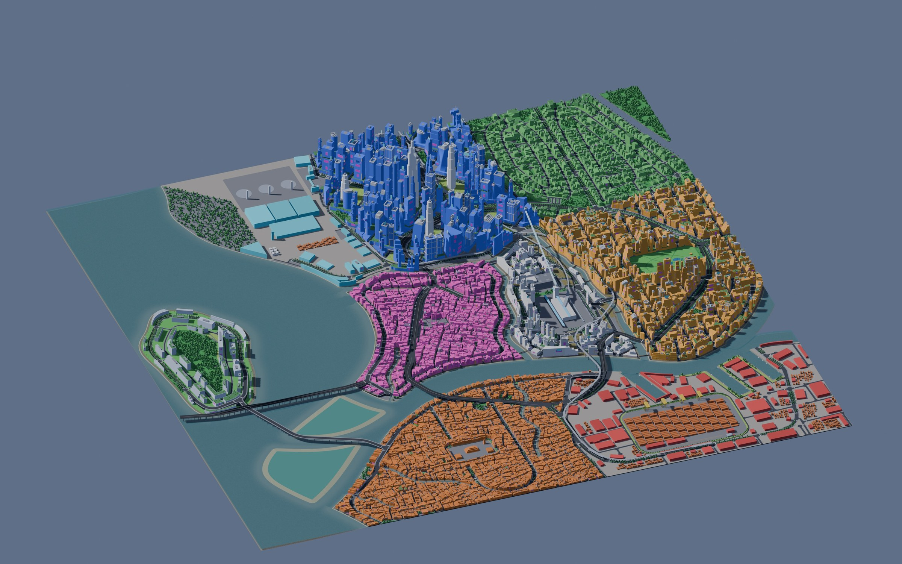
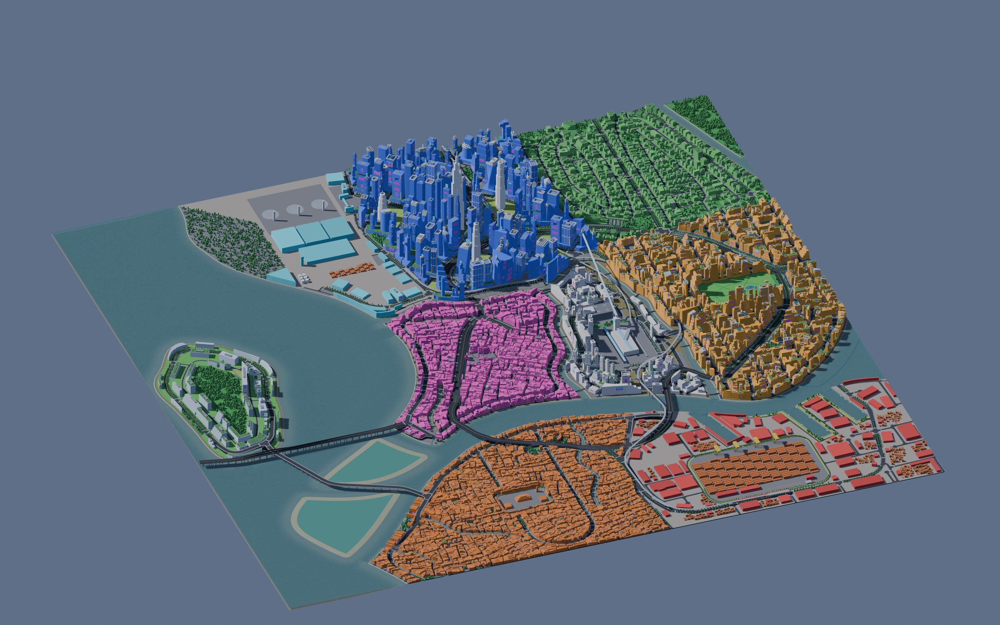
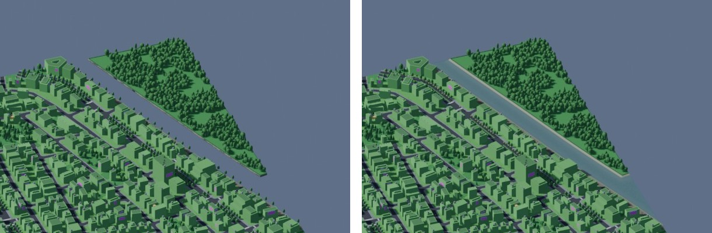
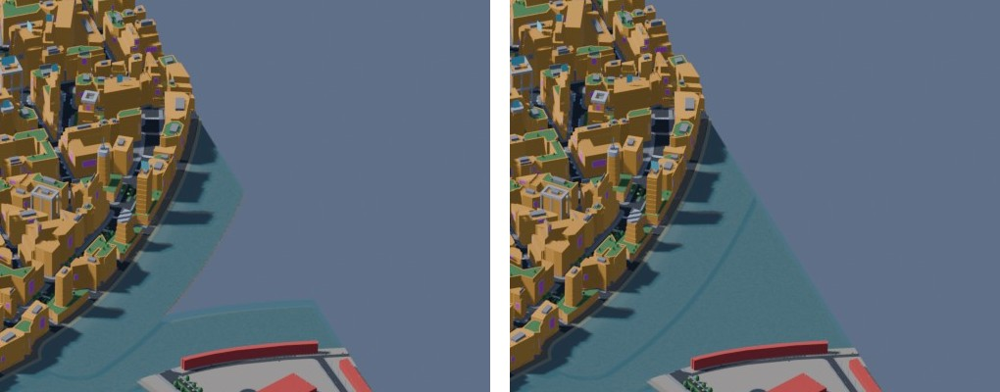

# Water coverage fixes (#140, #144's Nexus `water_gaps`)

Two fixes between milestones, both in Nexus City's water.

## #140: water no body has

In the whole-city render from #139, Nexus City's north-east corner showed the background
through a strip between the land and an islet at the map edge.

**Why.** The blockout's sea sheet `city.sea.<tile>` fills its whole tile under the ground, so
the blockout showed water wherever there was no land. AG12 takes every sea sheet: where a sea
body meets the tile it draws its own water, elsewhere it drops the sheet. Water that no model
body covers is then drawn by nothing, and the sky shows through.

The model left two kinds of water out of its bodies (`build.assemble`):
- **A body's other parts.** A body's polygon on the map's water, less the sea, can fall into
  several parts. The model kept only the largest. Nexus City's Kurosawa River comes in from
  the north-east edge, leaves the map at the east edge and comes back. Its first stretch in
  the north-east (37,219 m2) was dropped: that is the strip in #140.
- **Land the hydrology's opening took.** `rebuild_land` opens the land by 20 m, so land
  narrower than 40 m becomes water. Such water between two bodies is no body's. Nexus City
  had 22,617 m2 of it between Kurosawa River, Sentinel Canal and the east edge, a second hole
  in the same render.

Every city had some, from one sliver of 1.4 m2 (Saltreach Free Port) to 60,310 m2 in 21
parts (Nexus City); the table under Results lists them.

**Fixed in the model, not by AG12 keeping the blockout's sea.** A kept sea sheet is a flat,
opaque plane over its whole tile, 5 cm under AG12's surface. In a tile where AG12 also draws
water it would hide AG12's bed and caustics through the translucent surface, and the strip
would still have no bed, no banks of its own, no flow and no swim volume. Every consumer of
the water (M16's beds and banks, the ground cover, AG12, the Unreal exporter) reads the model,
so the model is where the water has to be.

`build.water_pieces` (in `assemble`) now gives every part of the map's water to a body:
- each part outside the sea and every body's main piece joins the water whose piece it
  touches: the one holding most of it (the sea, or a body's polygon on the map's water),
  ties by id. This runs again while parts join, so a part touching only another part
  follows it. A part joins the sea, or the body's main piece;
- a part touching no piece goes to the water holding most of it, else to the nearest, ties
  by id (the road stage's rule for the parts it takes as water, `roads.Net`). It is a
  further piece of the body, a row of its own (`attrs.part` 2, 3, ...), with its stretch of
  the body's centerline (`build.piece_line`). Cut off by the map's edge, it runs off the map
  there (`mouth` edge, no `flows_into`), so M13's levels do not take its end down to the
  sea;
- its stable id is the body's with the piece: `rv.kurosawa_river.part2` (`ids.base`; an
  unnamed separation channel's piece is named by its own anchor);
- only crumbs under 0.01 m2 (`WATER_CRUMB_M2`), the grid's, stay out.

**Slivers too.** A first version left out parts under 50 m2, as the road stage does (it
takes them as land). They are slivers along a shore, mostly under a bank's band, but not
always: on Vesper Bay a 16.9 m2 sliver between Vess River and a separation channel, 2.5 m
from the nearest bank line, left a hole of 1.4 m2 that the coverage check below found (the
small test city one of 1.8 m2). Every city has such slivers (up to 30 m2; the small test
city six), so every model moves. The road stage is unchanged: its routing still takes them as
land, and every city's `bridge_clearance` still passes.

Only Nexus City has a further piece (Kurosawa River's north-east stretch). Everywhere else
the leftovers join the water beside them.

Nexus City before and after (the blockout's `iso_city` camera, its `city.blend` with AG12's
water in place of the blockout water AG12 replaces or drops, flat colors):

The north-east strip (Kurosawa River's first stretch, the islet on the right) and the wedge
by the east edge between Kurosawa River and Sentinel Canal, before and after:

**`water_coverage`** (`assetgen/water/checks.py`, `uncovered`) now also takes the water a
blockout sea sheet showed: the map less its ground (the land less the rivers, channels and
waterways). Wherever AG12 takes the sheet, that water must be a body's or under a bank's band
(its line, `width_m` out); a part of 1 m2 or more left over fails, named by its tile. On
main's Nexus City it fails: `t+06+04 36703 m2, t+06-03 22617 m2`.

## #144: a crack in the bed

`water_gaps` failed on Nexus City: `sep.e126n468.bank.w5n461`, a waterline 0.05 to 0.20 m
over the bed. That bank's last waterline point, (-28.00, 463.39), lies on the bed's lattice
line x = -28. It is where the bank's dry strip ends, and the bed's edge there touches the
line at that vertex without crossing it. The bed's mesher (`grid.mesh`) clips the cells the
edge crosses and meshes the rest whole, two triangles a cell. So the cell to the right of the
line was clipped and had a vertex at (-28.00, 463.39), while the cell to the left was whole:
its edge ran from (-28, 460) to (-28, 464) past that vertex, 0.15 m under it. That is a
T-junction, a crack in the bed, and the gap check's point lay on it.

Now every cell and every clipped piece takes the vertices the clipped pieces put on its sides
(`grid._Sides`). A cell with none is meshed as before, so only where the edge touches a
lattice line does a mesh change. On main's Nexus City model the fix alone makes
`water_gaps` pass: two of its 111 water tiles change, with two more triangles in all.

## Results

Every city built on the final code, one at a time (citygen with the blockout, then `assetgen
water`); every check passes, each city on the same try as on main:

| City | Checks | Try | AG12 | Water outside the bodies on main, now a body's |
|---|---|---|---|---|
| Vesper Bay | 107 | 1 | pass | 13 parts, 14,492 m2 (13,250 m2 at the east edge) |
| Delta Megacity | 107 | 1 | pass | 16 parts, 234 m2 |
| Nexus City | 107 | 1 | pass | 21 parts, 60,310 m2 (a further piece of Kurosawa River, 37,609 m2) |
| Greyhook | 107 | 2 | pass | 3 parts, 2.5 m2 |
| Saltreach Free Port | 107 | 1 | pass | 1 part, 1.4 m2 |
| Cragmouth | 107 | 2 | pass | 2 parts, 7.6 m2 |
| Vesper Bay Decks | 112 | 1 | pass | as Vesper Bay |
| Vesper Bay Pinned | 107 | 2 | pass | 11 parts, 440 m2 |
| Vesper Bay Stacks | 107 | 2 | pass | as Vesper Bay Pinned |

Greyhook's, the pinned demo's, the stack demo's and Cragmouth's first tries fail the same
checks as on main, none of them water ones.

**Nexus City**, against main's build:
- the model moves only by its water and what stands by it: Kurosawa River's further piece
  (`rv.kurosawa_river.part2`); the sea, the river's main piece and five channels with their
  slivers (Sentinel Canal also with the wedge by the east edge); 72 waterfront palms in place
  of 92 street trees along the north-east strip; the wealth and moisture near it, 9 street
  densities, 2 places. One unnamed separation channel's id moves with its box (ids come from
  where an entity sits), and so do its banks' ids and the bridge that names it;
- AG12: 19 bodies (18), 115 tiles (111), 1,597,191 triangles (1,575,257); every water check
  passes;
- `assetgen streets` passes (9,617 pieces), then `fit`: nothing off its surface, no clash.
