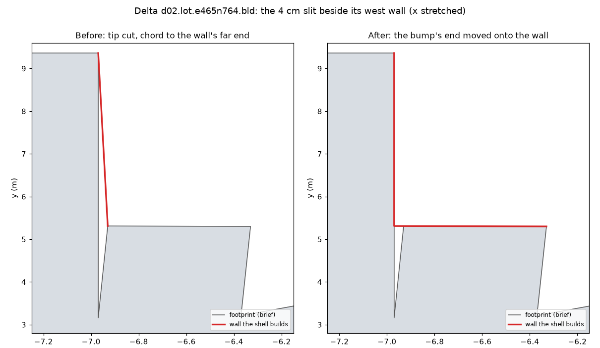
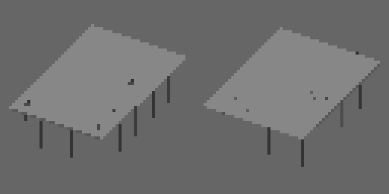
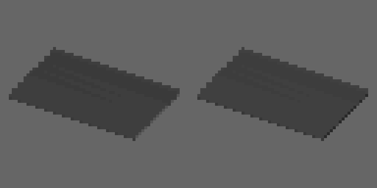
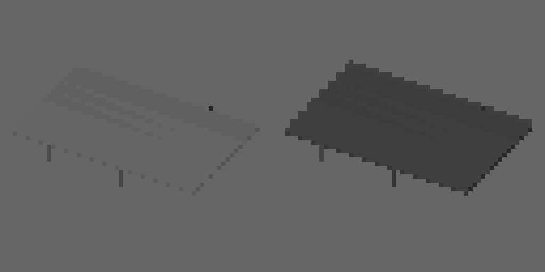

# One-building failures (#144)

Stage 2's checks failed on one or two buildings in three cities on M22's layouts. #156 fixed
the roof vents and AC unit (`asset_grounded`); these are the rest. Each was a gap in a
generator, fixed there.

## `asset_envelope`: a wall off a slit (Delta, `d02.lot.e465n764.bld`)

The perimeter block's footprint has a slit 4 cm wide (outside the building) between its west
wing and a small bump. `rings.tidy` removes a spike's tip and joined its two neighbors with a
chord, which here ran from the bump to the wing's far end, up to 4 cm outside the footprint:
six vertices of the wall's foot outside its envelope. Now, of the ways to close a spike (the
chord, or the shorter leg's end moved onto the longer leg's line), `tidy` takes the one whose
new edges keep nearest the outline (`_deviation`): the bump's end moves onto the wing's wall.

## `asset_unique`: twin sheds (Delta's pair 6 bits apart, Vesper Bay Pinned's 0)

Both pairs are AG5's open sheds (a roof on columns, no walls). The contact-sheet thumbnail
drew instanced parts only from a list that left out the sheds' pillars and every piece of
roof equipment, so an open shed drew as its roof plane alone; and its roof took the roof
color gene, while what told the pair apart (the walls' color) has nowhere to show on a
building with no walls. Pinned's pair is two 80 x 50 m sawtooth sheds with one roof color, a
red and a dark grey cladding.

- The thumbnail draws the pillars and the roof equipment (`thumb.DRAWN`).
- An open shed is roofed in its cladding, the wall-tinted `hangar` slot (`roofs.open_shed`,
  `slope_slot`, the slab in `types.shed_mass`), and its columns are painted in it
  (`pillar` style `painted`).

Delta's pair 6 to 60 bits apart, Pinned's 0 to 91 (8 needed). Before and after:

 

 

## `asset_clearance`: a barrel in a skybridge's corridor (Cragmouth, `d02.lot.w1085n239.bld`)

The shanty stack's roof water barrel was placed with `roofs._place` directly, not through
`types.put`, so it missed the corridor test every other type part gets. It now takes only
spots clear of the corridors over the roof, and so does the megablock's antenna farm (the
same direct placement).

## `asset_landings`: a podium deck with no wall (Cragmouth, `d05.sb.e1557s268`)

M3's podium-level open deck lands on the podium's roof at 22.4 m, its end 26.6 m from any
tower wall; the brief files every skybridge end under its nearest wall, here a 0.38 m chord of
the tower's curved wall, where no door fits. AG4 now takes an end farther than 1.5 m from
every wall as meeting none (`connections.wall_of`): one whose deck is at the top of a mass
under its end lands on that roof (`roof`, counted apart as `on_roof`, as a portal or the
ground floor is), else `no_edge`. Cragmouth has three such decks; every landing elsewhere is
within 1 cm of its wall.

## Builds (main at 25ea510, models at their goldens)

| City | Before | After |
|---|---|---|
| Delta Megacity | `asset_envelope`, `asset_unique` fail | every check passes |
| Cragmouth | `asset_clearance`, `asset_landings` fail | every check passes |
| Vesper Bay Pinned | `asset_unique` fails | every check passes |
| Vesper Bay | (its buildings golden moved: every GLB names `GEN_VERSION`) | every check passes |

Reports: `reports/`.
