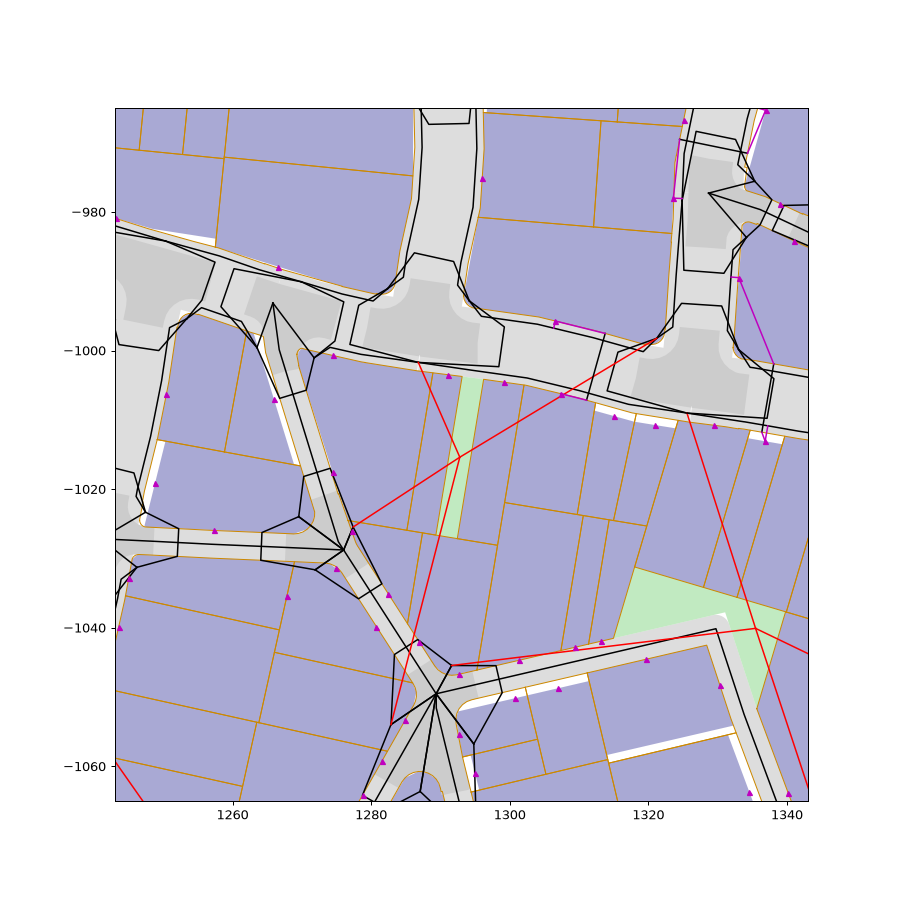
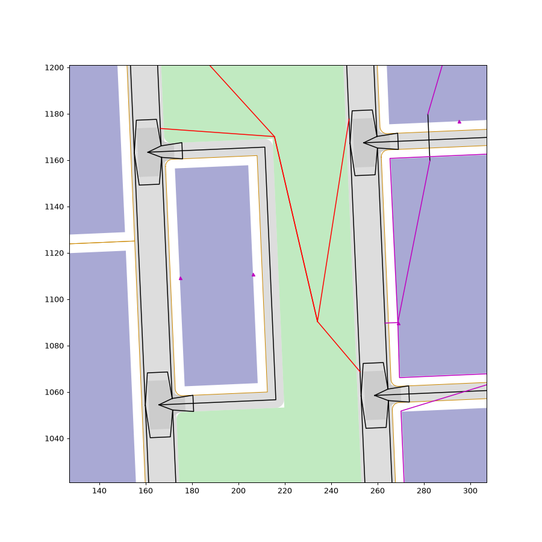

# Park paths fix

A fix between milestones, from PR #67's open items (`docs/run_through_1.md`): park paths
crossed lots and ran through buildings (342 to 801 crossing a lot, 287 to 711 through a
building in M17's builds), and about 3% of building entrances linked to their walkway through
another building. In citygen, walkers went through walls.

## What changed

- **Park paths on open land** (`citygen/parkpaths.py`). A path runs from an open space's middle
  to the nearest point of each ground walkway within 30 m of it (the walkway is split there:
  M2 paths used to reach only walk nodes, the corners at the ends of a block's sidewalk, so a
  park halfway along a block reached past its neighbors). Up to four paths, 25 m apart at
  their feet, those after the first at most 20 m outside the park (so none runs on beside a
  walkway to a far foot). A path is straight where it keeps 0.75 m
  off every lot, the water and the megasite reserves, else the shortest way bending at the
  open space's own corners, else one that may run along a lot's edge, never along the line
  between two lots.
- **Passages.** An open space no path reaches gets a 3 m strip along the shortest run of lot
  boundaries (between two lots, within 150 m) to a point from which a straight path reaches a
  walkway. The strip is taken from those lots, each kept whole with at least 65% of its area
  and its frontage. Lots of a complex, traced or held lots are never cut. One still without a
  way in says why (`attrs.access` none, `attrs.no_access`).
- **Sidewalk corners on the right of way** (`junctions._corner_point`). The corner was the
  middle of the two sidewalk points at the junction's cuts, which lies in the block's corner
  once the cuts are longer than the road is wide (streets with no sidewalk, M17's long cuts).
  It is now where the two sidewalk lines cross (under 180 degrees), else on the gap's bisector,
  moved toward the node until it lies on a leg's strip (as the leg curves) or the junction's
  right of way.
- **Every ground walkway off the lots** (`parkpaths.keep_off`): a stretch that cuts into a lot
  (a crossing's leg past a rounded corner, a link between walkway groups) is led round it, past
  the lots' corners; a deck's walkways round the lots on it.
- **Entrance, lobby, gate and station links** (`buildout.link_entrances`,
  `transit.Builder.foot`). A link that cuts into a building mass at its level goes to the
  nearest walkway it reaches clear, searched to 60 m past the nearest one (and on another
  landmass where its own has none), else the entrance moves along its own facade, else the
  link is led round the buildings (`_Masses.round`). A megasite building's entrance joins its
  site's own paths or one of its gates, and a megasite gate moves along its reserve's edge to
  where a straight link is clear. A lobby path (a skybridge landing to its building's door)
  is led round the buildings where its straight line is not clear, and a station's elevator
  core standing in a building leaves through it. An entrance with no way out at all says so
  (`Building.attrs.walled_in`).

## Checks

- `walkway_building_clash` (with the finished checks): no walkway, other than elevators and
  skybridge decks, runs through a building mass at its own height. Heights are measured over the
  ground; a mass from 2.5 m over its building's floor leaves room under it, and a grazing touch
  under 5 cm passes. A door, lobby or station path may enter its own building; a megasite
  gate's or a station's walkways may enter that megasite's buildings. No entrance's straight
  link to its walkway (or to the pieces a later stage split it into) cuts into a building at
  the ground of its level. Walled-in entrances and station stairs that pass a building are
  counted in notes.
- `park_access` (with the street checks): every park, plaza, pocket park, market, garden,
  promenade and beach has a park path or a walkway within 3.5 m of it, or says why. Park paths
  start inside their open space and stay off the lots. Islet parks (land without a district)
  are counted in a note.

## Before and after

The before builds are main's models (the six golden samples as AG12 built them on M18; the
pinned, stack and deck demos built on M19's main), the after builds this branch on M20's main.
A city's layout can differ between the two (another full-city try won), so the counts of park
paths and open spaces move for that reason too. There are fewer park paths: one from each
nearest walkway rather than one to each walk node, and none that runs on beside a walkway.
The measures (`measure_paths.py`, kept with these notes) count a park path as crossing a lot
when more than 0.5 m of it runs 0.1 m inside one, and as through a building when it runs
0.1 m inside a mass under 2.5 m. An open space has no way in when it has no park path and no
walkway within 3.5 m (islet parks included). An entrance link runs through another building
when the straight line to the nearest point of its named walkway enters another building's
ground mass 0.1 m deep (the few left after are this measure's reading of a walkway that a
later stage split: the check reads the pieces and finds none). The last column is the new
check's failures counted on each model (before / after).

| City | Park paths | Crossing a lot | Through a building | Open spaces with no way in | Entrance links through another building | Walkway check failures |
|---|---|---|---|---|---|---|
| Saltreach Free Port | 598 / 284 | 366 / 0 | 353 / 0 | 0 / 0 | 111 / 0 | 5016 / 0 |
| Delta Megacity | 925 / 401 | 550 / 0 | 528 / 0 | 2 / 0 | 126 / 3 | 8112 / 0 |
| Nexus City | 853 / 591 | 457 / 0 | 400 / 0 | 1 / 1 | 148 / 9 | 8347 / 0 |
| Greyhook | 616 / 490 | 329 / 0 | 277 / 0 | 31 / 3 | 28 / 0 | 2644 / 0 |
| Vesper Bay | 992 / 630 | 547 / 0 | 463 / 0 | 0 / 1 | 137 / 3 | 8096 / 0 |
| Vesper Bay Pinned | 1308 / 770 | 846 / 0 | 789 / 0 | 1 / 2 | 145 / 2 | 10792 / 0 |
| Vesper Bay Stacks | 1396 / 761 | 900 / 0 | 803 / 0 | 3 / 9 | 177 / 2 | 11113 / 0 |
| Vesper Bay Decks | 1001 / 683 | 549 / 0 | 485 / 0 | 2 / 2 | 139 / 4 | 8500 / 0 |
| Cragmouth | 737 / 415 | 395 / 0 | 391 / 0 | 0 / 1 | 161 / 0 | 10502 / 0 |

| City | Bent paths | Passages | Said no way in | Walkway stretches led round lots | Entrances relinked | of them moved | walled in | Checks |
|---|---|---|---|---|---|---|---|---|
| Saltreach Free Port | 23 | 1 | 1 | 183 | 149 | 79 | 0 | 102 of 102 |
| Delta Megacity | 34 | 0 | 0 | 257 | 176 | 109 | 0 | 102 of 102 |
| Nexus City | 56 | 0 | 0 | 324 | 207 | 129 | 0 | 102 of 102 |
| Greyhook | 43 | 0 | 1 | 96 | 36 | 18 | 0 | 102 of 102 |
| Vesper Bay | 60 | 0 | 1 | 300 | 197 | 115 | 2 | 102 of 102 |
| Vesper Bay Pinned | 68 | 0 | 3 | 344 | 233 | 131 | 0 | 102 of 102 |
| Vesper Bay Stacks | 69 | 0 | 9 | 353 | 245 | 133 | 0 | 102 of 102 |
| Vesper Bay Decks | 69 | 0 | 2 | 382 | 180 | 109 | 1 | 107 of 107 |
| Cragmouth | 33 | 0 | 2 | 402 | 244 | 166 | 0 | 102 of 102 |

The second table: park paths that bend, passages cut, open spaces that say they have no way
in, ground walkway stretches led round a lot, entrances linked to another walkway (and of
them moved along their facade), entrances walled in, and the checks passed.

Before (Vesper Bay Decks on main): park paths (red) run straight from a park's middle to walk
nodes across the lots (orange outlines) and the buildings on them (blue).

After: a park's paths run on its own ground to the nearest point of the walkways beside it.
Both drawn by `plot_area.py` (lots, buildings under 2.5 m, open space, rights of way, walkways;
park paths red, door paths magenta).

## Full-city tries

Every sample builds on as many full-city tries as on main: Vesper Bay, Nexus City and Saltreach
on the first; Delta (M19's `transit_clearance` on try 1), Greyhook (`walkway_graph` on try 1,
as on main), Cragmouth, Vesper Bay Stacks and Vesper Bay Pinned on the second; Vesper Bay
Decks on the third (deck columns and transit supports; one on M19's main). Ways round the
buildings and lots fall back on the outline the lots make together, a lobby path may run
through its own building, and a walkway-island link that cannot be led round the lots takes
another pair or runs beside the roads, so the new check no longer costs a try. The sample
build tests, alone on this PC with 2 workers: Vesper Bay 182 s, Delta 259 s, Nexus 152 s,
Greyhook within the limit on its two tries (main: Vesper Bay 163 s).

## Regeneration

Vesper Bay's Old Town regenerated on the after build (`citygen build ... --district "Old
Town"`): every check passes (103, with `regen_locality`), on its third seed (the first two
left one failure each); report in `regenerated/`.

## Open items

- Parks that touch only highways (Vesper Bay Stacks' The Stacks: six parks between the
  crosstowns' ramps; two in the pinned demo) say they have no way in: on main their paths ran
  to crossing nodes in the highway's carriageway. A passage needs lots to cut, and these
  have none.
- An entrance that reaches no walkway from anywhere on its facade, not even round the
  buildings, says so (`walled_in`: two in Vesper Bay, one in the deck demo) and its door
  path is counted in a note, not failed.
- Station stairs (M19's) that pass a building at their height are counted in a note.
- Lobby paths (a skybridge landing to its building's main door) are led round the buildings,
  else through their own building; a landing's own door would be the better design.
- A ground walkway stretch with no way round a lot would be left as it was
  (`walkways_in_lots`; none in the final builds, one in two earlier ones).
- The props golden (`tests/assetgen/data/golden_props.json`) needs a run on the Mac.
- Mac = x86 for the new goldens waits for the deferred determinism check.

## Outputs

Each city folder has the build report, `preview_detail.png` and the blockout's whole-city
render (`render_iso_city.jpg`) on this branch; `measures.md` is the tables above.
