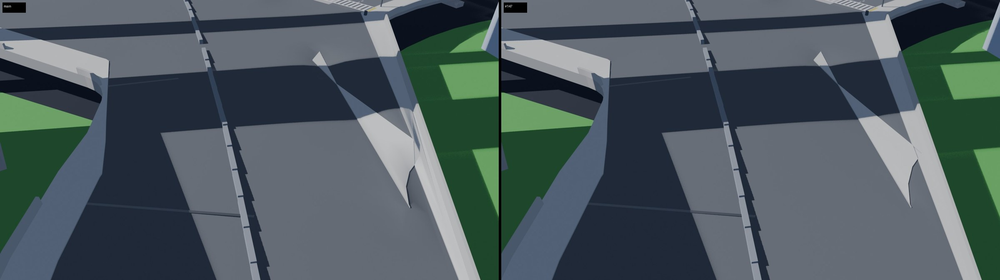
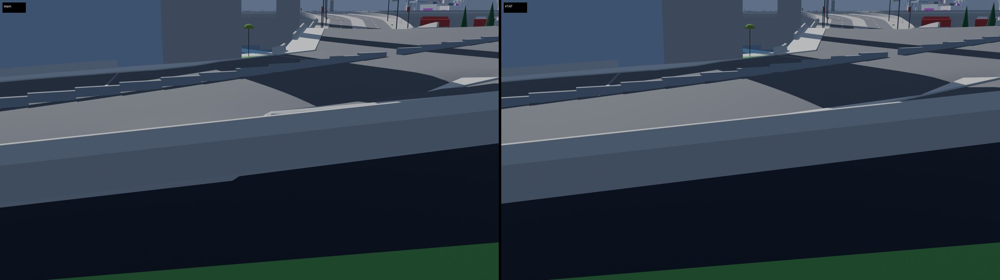
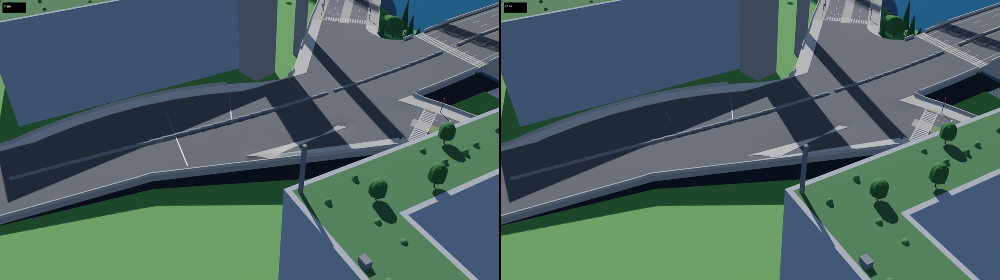
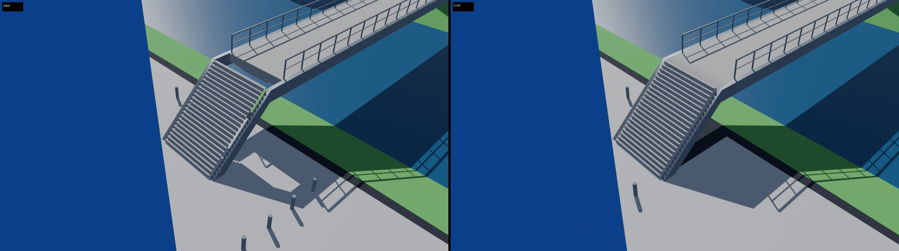
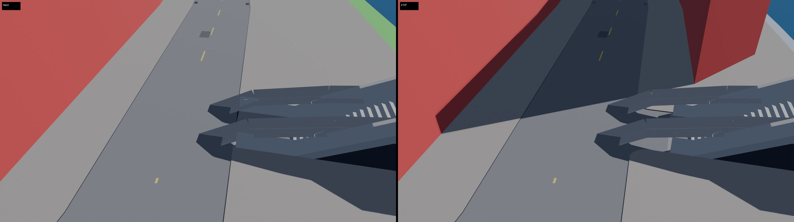

# Pavement map fixes (#147)

Fixes between milestones, from the two gaps AG17 (PR #146) found in M22's pavement map. AG17
draws stage 2's street pieces from the map, so they meet by construction wherever the map is
whole; in two places it was not:

1. **A folded corner pad.** Delta Megacity's `jn.e170s444`, the twin-ramp cluster that holds
   run-through 2's `jn.e217s328` (held as M18 left it, `attrs.unbuildable`, drawn grade
   0.896), had a corner pad folded up between the road at grade and its ramp 10 m up.
2. **Footbridges outside the map.** `pavement.Plan` skipped them, so AG17 drew their walking
   surface on their own profile from where their line left each junction (`walk_span`).
   Their seams with the junctions were not by construction, and `street_watertight` could
   not check them.

## What was wrong at `jn.e170s444`

The map gives a junction's curbs their heights by length along each ring, from port to port
(the curb rule). Between the road at grade and its ramp, the cluster's faces surround an
island (the gore's pads) that meets the outline through a narrow neck. There the ring goes
the long way round the island, so two vertices a stride apart took the heights of points the
island's whole round apart, 1.9 m different over less than a meter. The faces across the
neck folded up between them. No height fits this junction, so `junctions.buildable` keeps it
as M18 left it; the fold came from the curb rule, not from the two levels.

## What changed

`citygen/pavement.py`, `citygen/junctions.py` (stage 1), `assetgen/streets/roads.py` and
`barriers.py` (stage 2):

- **Folds** (`Assembly._unfold`, after the curb rule). K is the steepest slope between two of
  a junction's anchored vertices (its ports, a cluster's long curbs). A fold is a free vertex
  (the curb rule gave it its height, and only this junction's faces use it) more than
  `FOLD_TOL` (2%) steeper than K to another vertex of one of the junction's faces, or to a
  point every `EDGE_STEP_M` (1 m) along one of its edges. The two must be 0.25 to 4 m apart,
  with the line between them on the face (across a strip, never across a notch). The free
  vertices of the folds take the inverse distance weighted height of the vertices and edge
  points left as they are. They stay within the ports' envelopes (min and max of $z_a \pm K d_a$)
  and between the two heights the curb rule ran them between (`Assembly.bracket`: a curb stays
  between its legs' heights, as `junction_levels` holds it). The set grows while folds remain
  (`UNFOLD_ROUNDS`, 12). The result is kept when the faces it changes are drawn less steep at
  the steepest of them; otherwise the junction keeps the curb rule.
- **Footbridges in the map.** `Plan` lays a footbridge as any road: its walk face between its
  cuts, on stations that take its profile's knots (`Path.knots`), so the face turns where its
  stairs do. Its ports sit on its junctions:
  - its cut is no farther out than its stairs' foot (`junctions.stair_foot`, `foot_cuts`;
    M2 starts most stairs at the node, about 2 m inside M22's cut), so its port is at the
    junction's level and its stairs rise past it;
  - the stairs stand in a slot of the junction's region (`unit_regions` keeps footbridge
    legs, and its faces win any overlap, `FOOT_RANK`);
  - its faces meet another owner's only on its port lines (`Assembly._apart`,
    `_on_foot_port`). The stairs' sides and the slot's are outer edges at two heights
    (walls), and a junction vertex beside the stairs keeps the slot's height.
- **Stage 2.** AG7 draws a footbridge's faces as any road's: its outer edges walled down as a
  raised road's fascia, its girder under them from cut to cut, its railings within its cuts
  and off the junctions (#95's rule). `roads.walk_span` is retired.
- **Blockout.** Each footbridge is drawn from its faces again, one `<segment>.deck` object
  (on M22 it had no faces and the blockout left it out). AG7's footbridge piece replaces it.

### Choices

- **Smoothing the heights, not parting the levels or adding a wall.** The issue offered three
  ways out: part the cluster's levels, give the pad a wall, or give it a drop. But the fold
  came from the curb rule's heights, not from two levels meeting, so giving the curb sensible
  heights removes it. A wall or drop at the neck would have left a 1.9 m step where the ramp
  is still within a meter of the road.
- **Only where it folds.** A first version gave every free vertex of a folded junction its
  heights from the ports. It moved 122 of `jn.e170s444`'s 228 vertices, some 110 m from the
  gore. That lowered the surface under the raised ramp `rs.e193s386.2` until the ramp's girder
  showed through as a dark lens, and it bulged two flat pads at grade by up to 0.4 m. The fix
  moves only the vertices that fold (five at `jn.e170s444`).
- **Edge points.** pad_c is a strip 20 m long and under a meter wide whose far side is one
  edge with no vertex between its ends. A vertex 0.42 m across from that edge's middle sat
  0.32 m under it (a crease drawn at 42 degrees), and no other vertex was near enough to show
  it.
- **Each curb between its two heights.** Without that bound, Greyhook's cul-de-sac
  `jn.w192n935` took 0.1 to 0.19 m on a curb whose only leg is at 0. That broke
  `junction_levels` on every layout tried, and the city failed to build.
- **Footbridge ports on the line.** A junction vertex in the middle of a footbridge's port
  line, between its port points, kept a vertex of its own. In Delta, 6 of 34 footbridge ends
  (`jn.e540n598`'s two promenades meet 1 cm off one) were outer edges on both sides, so
  nothing joined them.

## Results

Every city on the final code, built one at a time (the deck demo has 111 checks, the others
106):

| City | Checks | Try | Footbridges | Ends joined (edges, segments) | Junctions unfolded |
|---|---|---|---|---|---|
| Delta Megacity | all pass | 1 | 17 | 34 of 34 (34, 40) | 5 |
| Vesper Bay | all pass | 1 | 6 | 12 of 12 (12, 16) | 2 |
| Saltreach Free Port | all pass | 1 | 5 | 10 of 10 (10, 13) | 0 |
| Nexus City | all pass | 1 | 20 | 40 of 40 (40, 58) | 1 |
| Greyhook | all pass | 2 | 2 | 4 of 4 (4, 6) | 1 |
| Vesper Bay Decks | all pass | 1 | 6 | 12 of 12 (12, 16) | 2 |
| Cragmouth | all pass | 2 | 3 | 6 of 6 (6, 8) | 33 |

Each city builds on the same try as in M22's builds (`docs/progress/M22/`). Delta: `jn.e170s444` is drawn at 0.225 (0.896),
and five vertices by the gore move. Four other junctions get less steep: `jn.w563n1125` from
0.583 to 0.402; `jn.w553n990`, whose main face goes from 0.441 to 0.187 (a strip pad stays at
0.505, next); and two milder ones. None gets steeper where it changes (`reports/delta_megacity_unfold.txt`).

Cragmouth (`reports/cragmouth_unfold.txt`): the unfold changes 30 hillside junctions. 29 get
less steep at their steepest and none steeper; the worst goes from 1.74 to 0.93, the median
from 0.243 to 0.155. Junctions steeper than their roads: 248 on M22, 241 now.

Delta's stage 2 (`assetgen streets`, then `fit`):
- 8,827 street pieces, 1,588,948 triangles (1,586,582 on main);
- `street_watertight`: 40,380 shared edges, 196,813 segments (196,763), 0 not drawn, open or
  drawn twice;
- no road steps onto its junction (4,430 legs), no clash, everything grounded on its surface.

At `jn.e170s444` the steepest street triangle goes from 75 to 36 degrees, and triangles over
10 degrees from 103 to 42.

## Renders

Main on the left, the fix on the right (AG7's street pieces over the blockout,
`assetgen/blender/streets_preview.py`).

The gore of `jn.e170s444`. On main the pad between the road and its ramp folds up against the
parapet; with the fix it lies with the ramp:

The neck, low along the ramp's parapet. On main the pad's folded edge stands up over the
parapet:

The cluster from above:

A footbridge's stairs meeting the promenades at grade (`rs.e540n618` at `jn.e540n598`). On
main its walk started where its line left the junction, with an open hole at the stairs' top;
with the fix its faces run from the stairs' foot, joined to the junction's:

A footbridge's foot at a street corner (`rs.w1659n419`). The warehouse beside it
(`d05.lot.w1679n104.bld`, the same lot as on main) now reaches the corner, its footprint
moved with the junction's new slot:

## Open

- **Steep, but not folded.** `jn.w553n990`'s strip pad (pad_e, 0.505), `jn.e208n469` (0.181)
  and `jn.w263n1283` (0.203) are drawn steep without a fold: interior samples across a strip
  whose two sides differ in height. They stay held as M22 left them.
- **`jn.e170s444` is still held** (drawn 0.225 against its roads' 8%): the cluster's two levels
  meet within its faces. Where the ramp `rs.e193s386.2` rises over the cluster's
  carriageway, its girder's underside is 0.27 m under the junction's surface (0.08 to 0.17 m
  on main), unseen.
- **Cragmouth's hillside junctions** still steeper than their roads (M22's open item:
  primary roads keep their grade through their junctions).
- **No Unreal check** (the coordinating session's call).
