# Play fixes (after the packaged Delta, 2026-11-12)

Five fixes from Swagnik's notes after he walked the packaged Delta Megacity. Built and checked
on the Windows PC (RTX 4070 Ti, 32 GB), 2026-11-13.

## 1. A body that walks: Play starts in first person

`citygen unreal`'s `--play` now defaults to `walk` (it was `fly`). The play plugin has a
character of its own, `ACityGenWalker` (`citygen/ue/CityGenPlay/.../CityGenWalker.h`). The
importer makes it into `Core/BP_CityGenWalker`, wearing the project's own character's body,
and the level's game mode override `Core/GM_CityGenWalk` spawns it (`import_city.walk_classes`,
`project_body`).

- **Why the old walk had no body.** The First Person template's character (CityAG16's
  `BP_FirstPersonCharacter`) has two meshes:
  - its world body, `SKM_Manny_Simple` with `ABP_Unarmed`, which its own player never sees
    (`owner_no_see`);
  - a first-person mesh of arms only.

  Play also flew by default, so walking needed `--play walk`.
- **The body.** The walker wears that world body and its animation. The camera sits 1.64 m up
  at the eyes, so looking down shows the chest, arms and legs. In the player's own view the
  head is hidden (`neck_02` and what hangs off it). A second copy of the body, drawn into
  shadows only, casts the whole figure's shadow. Seen from the free camera, the head is back.
- **Controls.** W A S D or the arrows walk, the mouse looks, Shift runs (8.5 m/s; walking is
  4.2), Space jumps, and the left stick walks. The keys are bound on the walker's own input
  component, so no project input settings are needed. A key is tracked by its press and
  release: bound as an axis it raised an ensure in the packaged game. The play features'
  `.` swaps to the free camera and back. Step height is 45 cm (curbs and stairs).
- **`--play fly`** stays (the fly pawn). `--play project` is the project's own game mode and
  pawn, which is also what `walk` falls back to when the play plugin cannot be built.
- **`--check`** walks with the walker and adds two checks:
  - `spawn`: on its feet by the player start, what it stands on, and a body it sees;
  - `curb`: off a sidewalk's curb onto the road and back up to the sidewalk's height.

  The walk's time allowance follows the pawn's speed. With `--shots` it takes
  `unreal_walk_body.png` and `unreal_walk_ahead.png` by day (from a `--view walk_spot ...`
  if given).
- **A packaged game's proof.** `-CityGenSelfie=SECONDS` on the command line turns day on,
  takes a screenshot looking down and one looking ahead, walks 2 s with W held, logs
  `CITYGEN_WALKER` lines and quits.

| The packaged Delta, looking down | The small test city (blockout), looking down |
|---|---|
| 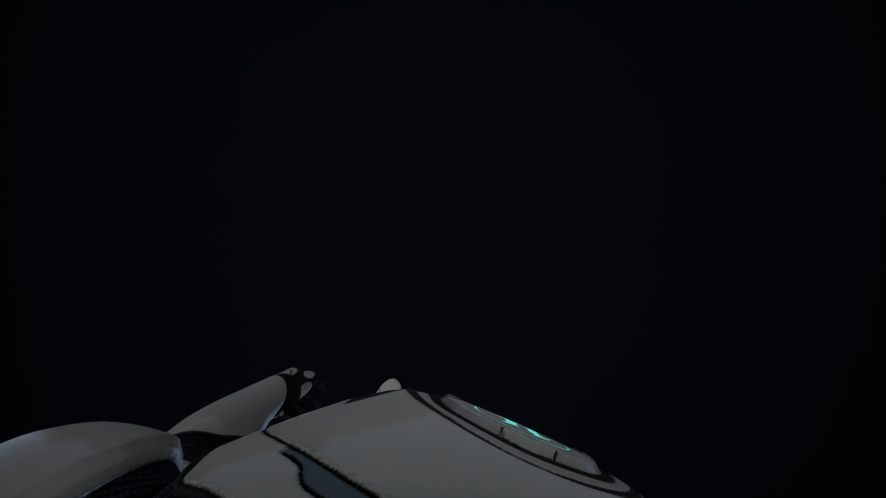 | 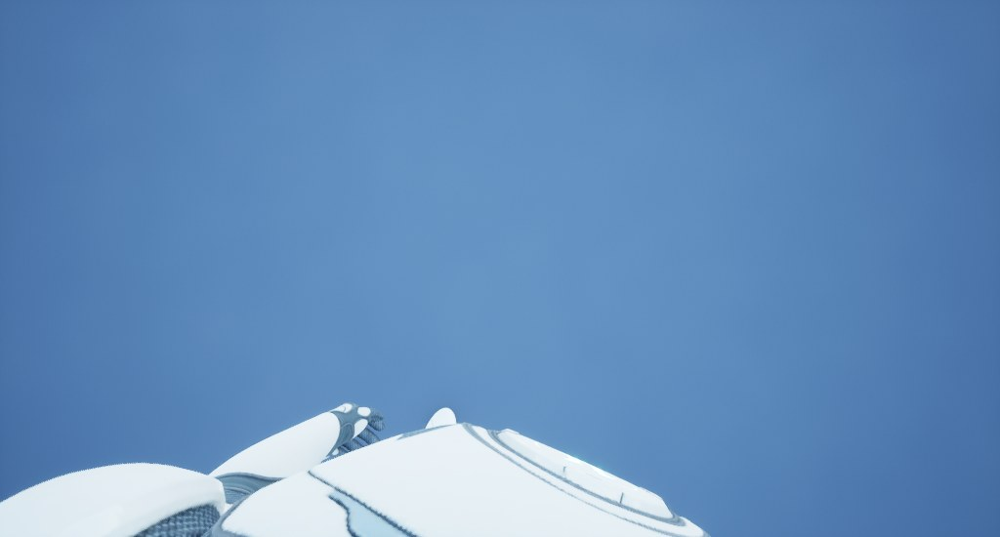 |

Delta's player start (the Industrial Port's fast travel point) lies under a viaduct, so the
packaged shot is dark even by day.

## 2. The Aurels out

`aurel_prelate`, `aurel_regent` and `aurel_zenith` are never placed or imported, as the
three Vex cars are not. Their scripts stay in `vehicles/cars/`. They are listed in:
- `assetgen/parked/table.EXCLUDED` (the parked cars);
- `citygen/unreal_vehicles.EXCLUDED` (the exporter: never imported with `--all-vehicles`, and a
  placement naming one is refused);
- `vehicles/packs.py` (not shared: out of `packs.json`, `fetch` and `status`);
- `vehicles/survey.py`.

Delta now parks 15 models.

## 3. Never three of one car in a row

`assetgen/parked/place.py` tries each spot's candidates (the district's weighted order by the
car's id) twice:
1. first every model but the one before it on the curb;
2. then that one too, but never as the third running (`MAX_RUN` 2).

So two of one model run only where nothing else fits the spot. The check `vehicles_variety`
fails on three in a row, or when same-model neighbours reach `MAX_PAIR_SHARE` (5%) of the
curb neighbours. The report gives the share.

**Delta:** 3,452 parked cars, 3,431 placed as 15 models. 1 of 2,848 curb neighbours is a pair
of one model (0.04%), and the longest run is 2. On main the same build had 306 of 2,848
(10.7%) and 26 runs of three, with 18 models. A test fails on a forced run of three
(`test_variety_check_fails_on_three_in_a_row`).

## 4. The tables in the road: station canopies, not bus shelters

The structure in the benchmark's `walk_d03` shot was not a bus shelter (M6's `bus_stop`). It
was the metro entrance canopy `stn.corporate_core.2.entb`: a 5 m square roof on four posts
over the stair foot, centred on the sidewalk point nearest the stair. At a junction's corner,
half of it stood on the carriageway. The elevated stations' stair canopies (6 m squares on
posts) did the same: in Delta, West Quay's stood 80% and 100% in the road and Old Town's
metro entrance 100%.

M5 (`citygen/transit.py`) no longer lays either. The stairs, elevators and walkways are as
before. They were the only kind of thing in the road. AG7 drew both as a slab on posts with
no stairwell under it, so nothing of the entrance is lost. Bus shelters stand on the
sidewalk and stay. Megasite canopies (bus bays, truck gates) are inside their sites and stay.

| The benchmark's walk_d03 start, before (AT3) | After |
|---|---|
| 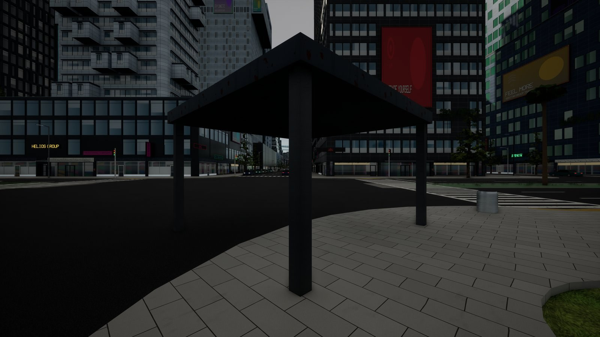 | 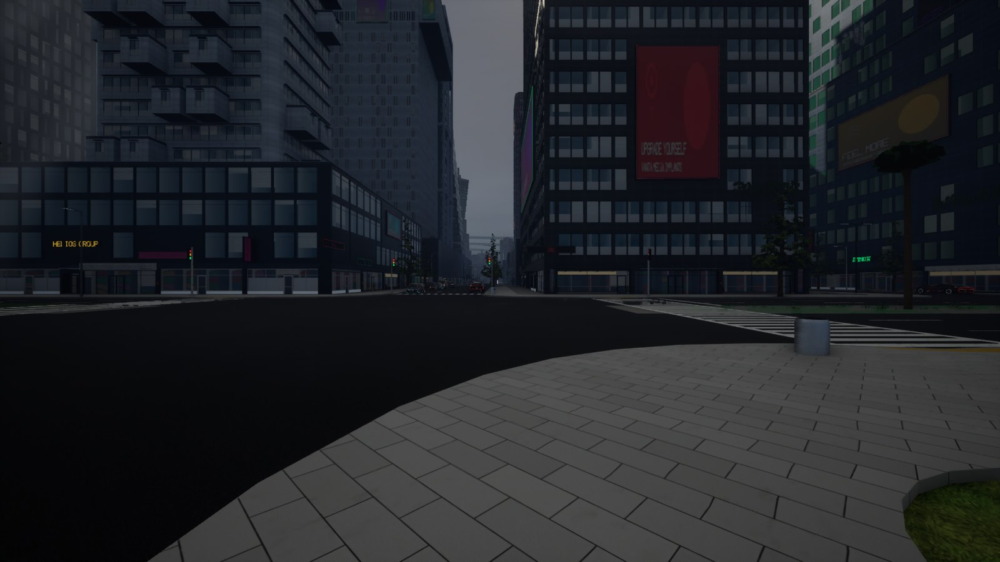 |

Every city has stations, so every sample's model and blockout plan change (citygen's goldens
are rewritten, `tests/data/golden_hashes.json`). All nine cities pass every check: the five
samples, the pinned and stack demos, and Cragmouth with 107 checks each; Vesper Bay Decks
with 112.

## 5. Car glass that reads as glass

`M_CgVehicleGlass` (the importer's, so the packs need no rebuild; `VEHICLE_VERSION` 10):
- the glass color is pulled toward a dark teal (`GlassTint`, `TintMix` 0.6) before it is
  squared as the transmittance;
- a share of the glass is covered (the pack's transmission times `TransmissionScale` 0.65),
  and more toward grazing angles (`GrazingCover` 0.6 of $(1 - N \cdot V)^4$), on top of the
  shading model's own Fresnel;
- the reflectance is at least `MinF0` 6%. The domes' IOR of 1.12 to 1.14 had reflected almost
  nothing.

- the material is two-sided. A face is left out when, its normal turned outward from the
  car's middle, the eye is behind it (the far side's glass); it used to be left out when its
  normal pointed in. The Tanager Cab's front side windows are one sheet facing in, so from outside they drew
  no glass at all: its near faces were culled and its far faces left out.

The cabin is now a dim shape behind reflections. The street shots below are of version 8 (the
first round); version 10 is darker again and two-sided (the hero shots under "Checks").

| By day | By night |
|---|---|
| 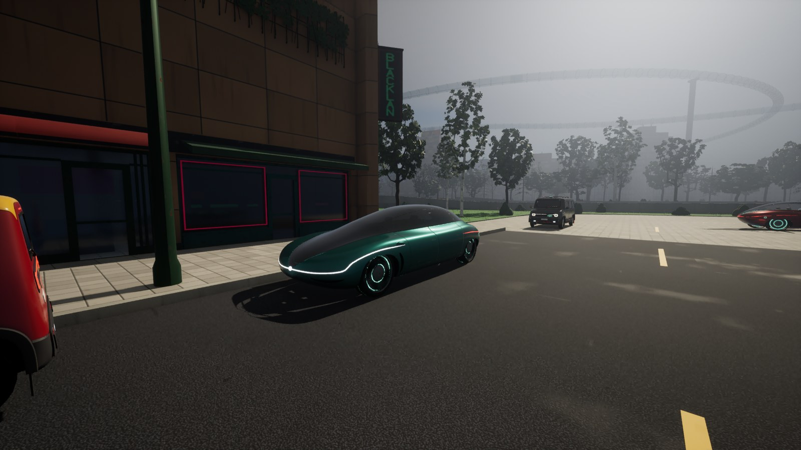 | 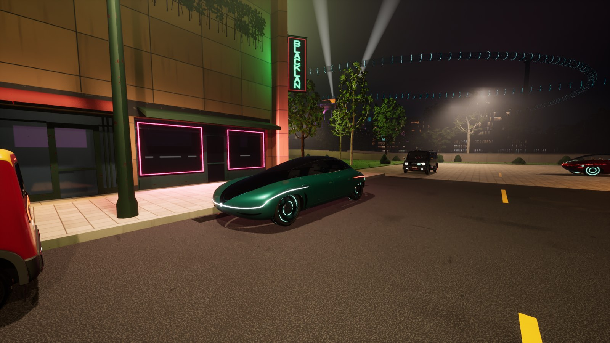 |

**Left open: the Tanager Cab.** After version 10 its front side window reads as tinted glass,
but its windshield and the other side windows still look clear from outside, much as before.
From inside, its side windows are dark glass and the windshield still has none. Its pack's
proof shows light, clear glass in those windows (glass color 0.6 to 0.68). Whether those
openings carry glass faces in the pack's LOD0, and which way they face, is for a look at
`game.py`'s glass for that car.

## Delta in Unreal

Delta was built again from the branch: `citygen build --blockout`, `assetgen build`, and
`atmosgen plan`. The frozen AG16 build predates main's model changes and still had the
canopies. It was imported over the AT4 import in CityAG16 in 1 h 53 min:
- actors: 476 created, 6,160 updated, 448 deleted;
- stage 2 meshes: 31,321 imported;
- every car made again for the glass;
- 632 HLODs built.

`assetgen vehicles` was also run on the frozen build (`builds/ag16/delta_megacity`), so its
contribution has no Aurels either.

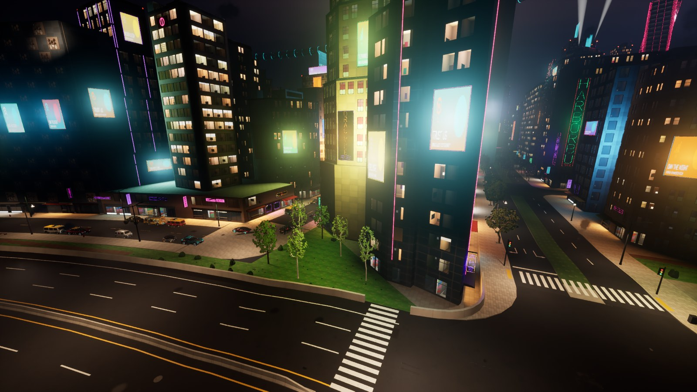

The packaged game (Development, Win64, 3.0 GB) is at
`C:/Users/swagn/CityGen/builds/packaged/Delta_fixes/Windows/CityAG16.exe`, packaged from
CityPackaged, a copy of CityAG16. Smoke run with `-CityGenSelfie=60`: BP_CityGenWalker with
SKM_Manny_Simple, seen by its player, on the ground at the player start, and W held walks
8.0 m in 2 s.

That smoke run was launched without `-userdir`, so it left a `Saved/` folder in the package
whose `GameUserSettings.ini` kept its 1920 x 1080 window: Swagnik's first start opened at that
size, not his native 2560 x 1440. The rule now in `docs/unreal_export.md` ("A packaged game")
and CLAUDE.md: a smoke or test launch leaves no `Saved/` in a package (`-userdir=` outside it,
or delete it after the run).

## The night's frame time

The lean benchmark ran once (`--bench-atmos`, `night_plan_all`; `bench/`) with the walker as
the pawn and the first round of darker glass (`VEHICLE_VERSION` 8; version 10's coverage
and two-sided faces were not benchmarked). The p95 was 15.5 ms over the route: walk
15.6, drive 15.3, flight 15.7. AT4 left it at 15.6, and the budget is 16.7. Delta's model is
the branch's here (no station canopies, and main's later model changes). The bench moves the
pawn itself, so the walker's body is below the view.

## Checks

- **Delta's city check** (`--check --shots`): passes. Spawn on the ground, 0.0 m from the
  player start, with a body it sees; a walk of 345 m along a 347 m sidewalk path, 100% of
  frames on the ground; a curb stepped 0.07 m down and back up; the console, play features,
  sky, air and flight as before.
- **The vehicle check** (`--check-vehicles`): meshes, placements and wheels pass. Collision
  fails for the Kestrel Atlas only (88 of 132 side traces hit; its known pack fault: its
  hulls leave the open cab uncovered). Every other car passes.
- **Tests:** `tests/assetgen/test_ag_vehicles.py`, `tests/test_unreal_vehicles.py` and
  `tests/test_unreal.py`'s play flags and its two small-city imports into a fresh First
  Person project. On the small city the walker spawned on its feet, walked 133 m, climbed a
  0.15 m curb, and the free camera came back to it.

| A Tanager Cab by day, before (AT3) | After |
|---|---|
| 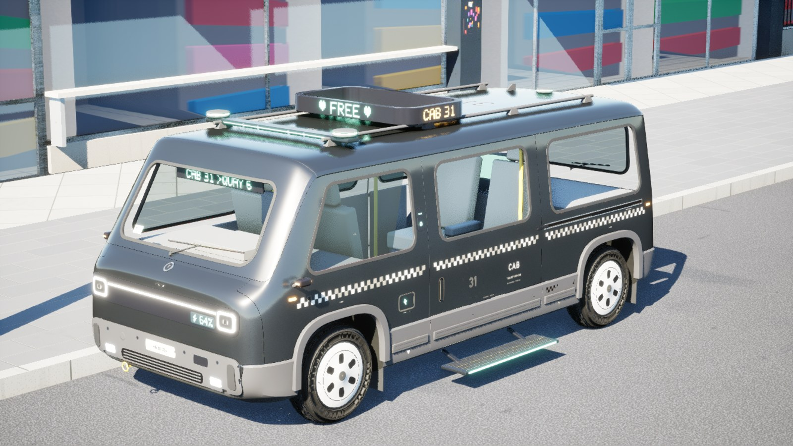 | 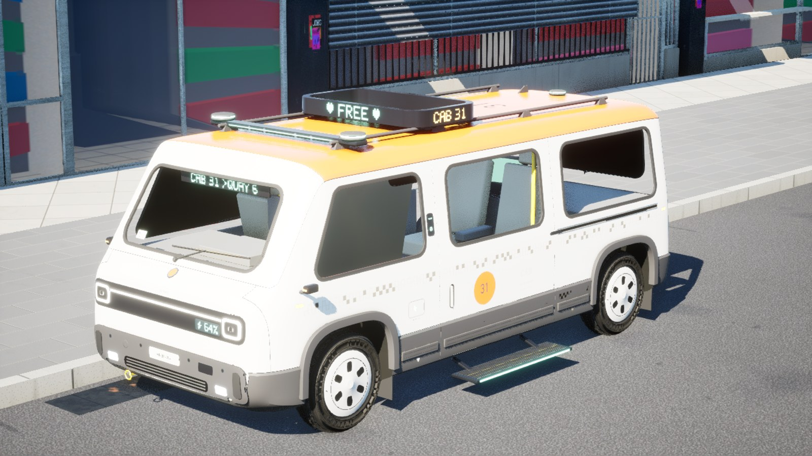 |
| **An Orrin Pebble's dome, before** | **After** |
| 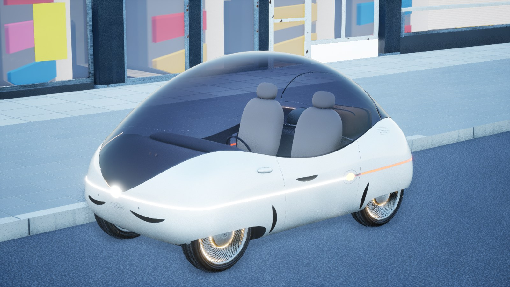 | 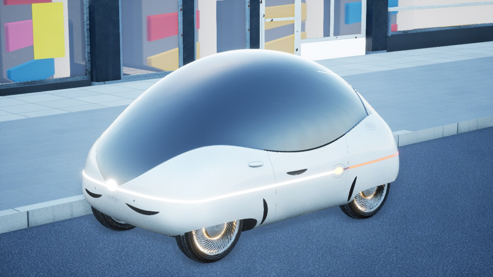 |

The Tanager Cab from its seats (version 10): 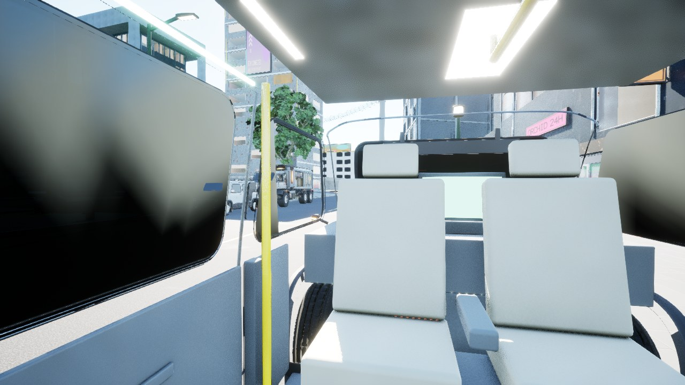
