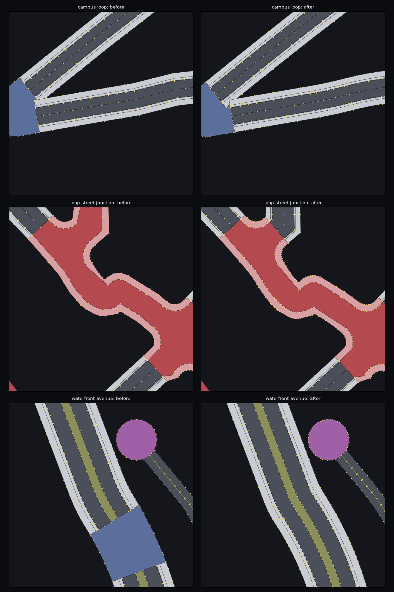
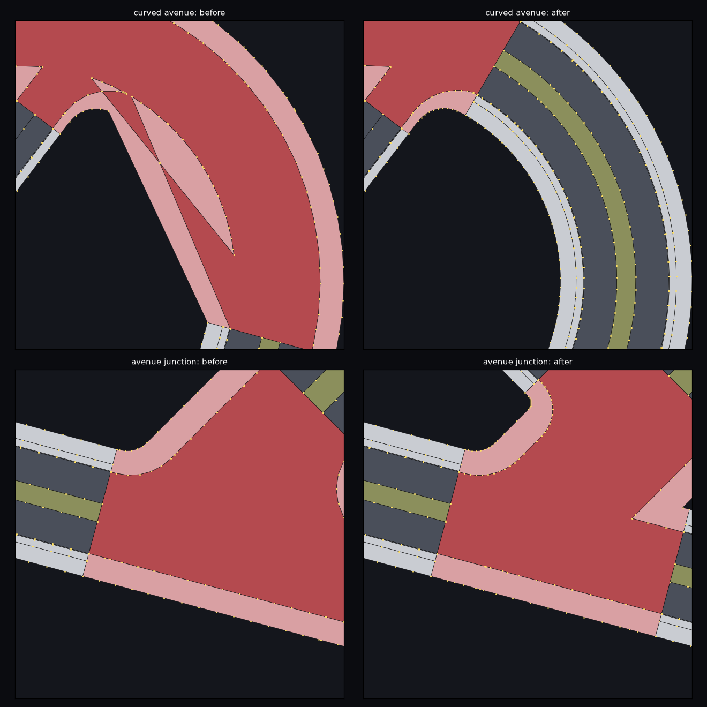
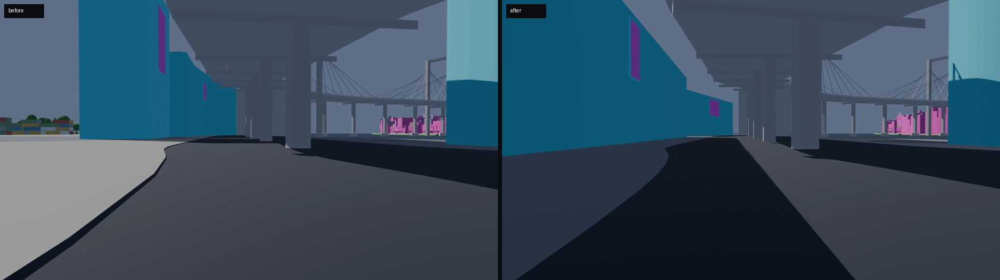
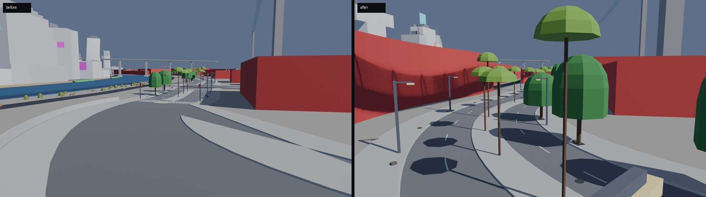
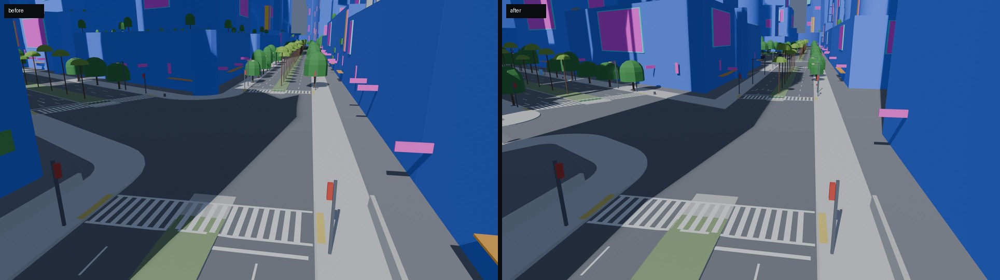

# Road curves fix (smooth road geometry)

A fix between milestones, from cars_steam's open item (`docs/progress/cars_steam/README.md`):
the roads' own curves were as coarse as M22's pavement map and AG17 drew them, a bend a few
stations, a junction's corner a few vertices, so faceted asphalt, curbs, sidewalks and
barriers showed at street level and LG5's smoothed car lanes cut inside a drawn corner.

## Where the curve was lost

Measured on main's Delta Megacity and Vesper Bay (`measure.py`: at every vertex of a road
centerline or a pavement edge that turns up to 45 degrees, the sag of a circle's chord
sampled at that turn, `(chord / 2) tan(turn / 4)`, at the road's outer edge for centerlines;
the map's 4 m stations on a straight chord merged first):

| Source | Vertices over 2 cm (Delta, main) | p95 | max | Lost where |
|---|---|---|---|---|
| M2 organic streets | 2,239 | 18 cm | 113 cm | the street *is* a polyline: an agent's 8 m steps, turning up to 10 degrees and a wobble each |
| M2 alleys, infill, frontage, promenades, loops, campus loops | 1,551 | 86 cm | 324 cm | polylines along the district boundaries, the water and the lots (Douglas-Peucker at 1 to 4 m) |
| M2 ring streets (radial pattern) | 35 | 121 cm | 265 cm | `_ring_pts`: a circle cut every 14 m |
| M1b avenues and highways (waterfront, ring road, connectors, chords, crossings, spines) | 1,054 | 14 cm | 193 cm (a join) | `roads._arc_line`: each fillet cut every 6 degrees or 12 m |
| M7 loop ramps, turns | in the ramps | 4 to 9 cm | | `elevated._turn` (5 m), `_loop` (5 degrees) |
| junction corners (curb returns, corner pads) | 12,417 curb vertices | 7.5 cm | 136 cm | `junctions._arc`: 15 degrees a chord |
| cul-de-sac bulbs, bend faces | | 10 cm | | `pavement._circle` (24-gon), `fold_poly` (4 segments a quarter) |

So the curve was lost at its source in every case: arcs sampled coarsely (M1b's fillets, M7's
turns, M2's rings, junction corners, bulbs), and M2's local streets have no curve at all
upstream (their polylines are what the generators lay). Grid rounding (`geom.q`, 1 cm) loses
at most 0.7 cm and is not where the facets come from.

## The fix

- **Arcs at their source, cut by sag** (`geom.arc_steps(r, sweep, sag)`, M21's rule:
  a step of $2\sqrt{2\,\mathrm{sag}/r}$ never sags more than `sag`, `G.ROAD_SAG_M` 2 cm; plain
  arithmetic): M1b's fillets at the outer edge of the class (`roads._arc_line(..., hw=)`;
  transit keeps M1b's steps; a fillet the corners left under `ARC_OK` 0.98 of its class's
  minimum radius keeps M1b's 12 m chords: measured on its true arc it fails `curve_radius`,
  which main's coarse chords passed, and the small test city's road search moved to another
  hydrology variant; a joint of a highway and an avenue holds the highway's minimum), M7's turns and loops (`elevated._turn`, `_loop`, the ramp's
  outer edge), M2's ring streets (`streets._ring_pts`), junction corners (`junctions._arc`,
  also the map's `_core`), bulbs and bend faces (`pavement._circle`, `fold_poly`).
- **Local roads' corners on arcs** (`streets.round_edges`, `round_corners`), on the settled
  graph before the segments are written, so junctions, lanes, sidewalks, the map, blocks,
  lots and buildings are all built on the curve: each inner vertex turning up to 75 degrees
  becomes an arc tangent to its two chords, its run at most half of each chord, the arc's
  middle within `ROUND_DEV_M` 0.5 m of the vertex, its radius keeping the road's inner edge
  `ROUND_PAD_M` 0.5 m from the center (else the vertex stays a corner); two arcs that would
  leave a stub under `ROUND_JOIN_M` of a chord between them meet at one point. Primary roads
  (their own fillets), footbridges, traced roads and, in a regeneration, held roads stay.
- **The map's stations** (`pavement.Path.stations`): on curves cut this fine a road's cut
  often falls within centimeters of a vertex, and two vertices of adjoining arcs lie
  centimeters apart, so a band edge stepped back between a mitre point and a square one (a
  real zigzag in the drawn edge, which `Road.folds` turned into a bend face: Vesper Bay's
  bend faces went from 81 to 137 with the fine arcs alone). A vertex nearer a stretch's end,
  or another vertex, than its widest edge's mitre reaches along it (`Path.reach`, `_reach`:
  reach times tan of half the turn, from the mitre factor) is left out of the stations.
- **AG17** draws the map as it is (no change to the street stage's drawing). Its junction
  corner barriers keep off the crosswalks (`barriers._keep_out`): since the crossings fix put
  a road's crosswalks at its corners, guard walls stood on them, and AG14's `asset_clash`
  failed on main (Delta 33 `barrier_on_crosswalk`, Vesper Bay 11).
- **Found on the new layouts** (each city's layout moves, so the later stages met layouts
  main never had):
  - `ground_cover` counted a 1 cm sliver along a 322 m lot edge beside a canal, which snap
    rounding left between the lot and the water (1.5 m2), as a piece under the water: parts of
    an overlap thinner than `GRID_SLIVER_M` 5 cm are the grid's (`water_checks`). Vesper Bay
    failed its first layout on it.
  - An elevated station's stair whose straight run down passes through a building mass at its
    height (a mass on an arcade, which the ground test missed) gets an elevator and a path, as
    round the buildings (`transit.Builder._stair_blocked`, the check's own `_Masses`).
  - Park path benches and their trash cans keep off the carriageway of a road the path
    crosses (`props.park_benches`, `CARRIAGE`): AG14's fit check found one on a highway's
    median in the small test city.
  - `walkway_building_clash` tests an entrance's link to each of its walkway's pieces within
    `TIE_M` 5 cm of the nearest and passes when any is clear: a later split left a 22 cm
    sidewalk piece whose end lay a millimeter nearer the entrance than the foot on the piece
    beside it, and the link to that end clipped a shop row (the stack demo's third layout).
  - **Seven layouts on a city's roads before another road network** (`build.LAYOUT_SALTS` 3
    to 7, `CITY_RETRIES` 8 to 23). A city's later stages pass on some of its layouts and fail
    on others, and main's samples sit on a lucky one: replayed on main, Delta's layouts 1 and 3
    fail (`transit_supports`), Vesper Bay's 1, 2 and 3 fail (a station stair through a
    building, a sky tube's profile, a crossing on a carriageway, an entrance walled in). Every
    change to the roads moves every layout, so the cities fall on other draws: on the curved
    roads Delta's first four fail (a sky tube's flat station under a portal cap with buildings
    past it, `transit_profile_smooth`; transit clearance and supports; a station path), and
    with three layouts a network it went to another hydrology variant and failed all nine.
    Every city that passes within four layouts is unchanged by this.
  - M1b's fillets: only arcs of at least `roads.ARC_OK` 0.98 of the class minimum are cut
    fine (`_arc_line`'s `r_ok`; a joint of a highway and an avenue holds the highway's):
    measured on its true arc a fillet the corners left under the minimum fails
    `curve_radius`, which its 12 m chords passed on main, and the small test city's road
    search moved to another hydrology variant.

## Before and after

Pavement map (M22) of each city, main against the branch. Road edges: the band and outer edges
of the roads' faces; junction curbs: the curb and outer edges of the junctions' faces (corner
returns, pads, bulbs); each "p95 / p99 / max" of the chord sag per vertex (cm), and how many
vertices sag over 10 cm (what is left: corners turning 45 degrees or less that stay corners,
fillets under `ARC_OK`, traced roads, M7's diamond ramps). Layout: the try a city builds on.

| City | Layout (try) | Faces | Vertices | Bend faces | Road edges p95 / p99 / max (cm) | over 10 cm | Junction curbs p95 / p99 / max (cm) | over 10 cm |
|---|---|---|---|---|---|---|---|---|
| Delta Megacity, main | salt 0 (1) | 18,226 | 278,502 | 74 | 15.0 / 60.1 / 212 | 4,778 | 6.8 / 12.2 / 136 | 1,194 |
| Delta Megacity | salt 4 (5) | 19,076 | 321,081 | 66 | 1.9 / 2.0 / 95 | 63 | 2.0 / 2.1 / 88 | 60 |
| Vesper Bay, main | salt 0 (1) | 19,650 | 292,212 | 81 | 18.6 / 73.1 / 354 | 4,220 | 6.8 / 12.4 / 138 | 1,342 |
| Vesper Bay | salt 7 (8) | 19,604 | 330,516 | 74 | 1.8 / 2.0 / 232 | 74 | 2.0 / 2.1 / 132 | 55 |
| Saltreach Free Port | salt 0 (1) | 10,345 | 194,131 | 53 | 1.9 / 2.0 / 136 | 55 | 2.0 / 2.3 / 100 | 49 |
| Nexus City | salt 0 (1) | 21,309 | 358,059 | 73 | 1.8 / 2.0 / 262 | 97 | 2.0 / 2.2 / 114 | 101 |
| Greyhook | salt 2 (3) | 11,195 | 216,042 | 25 | 1.9 / 2.0 / 92 | 18 | 2.0 / 2.0 / 57 | 20 |
| Cragmouth | salt 1 (2) | 23,226 | 362,249 | 69 | 1.8 / 2.0 / 99 | 86 | 2.0 / 2.2 / 194 | 75 |
| Vesper Bay Pinned | salt 1 (2) | 22,505 | 346,923 | 77 | 1.8 / 2.2 / 299 | 167 | 2.0 / 2.2 / 106 | 66 |
DECKS_ROW
| Vesper Bay Stacks | salt 2 (3) | 21,498 | 341,339 | 80 | 1.8 / 2.7 / 156 | 251 | 2.0 / 2.2 / 106 | 50 |

On main, Saltreach, Nexus and Greyhook measured (from the play fixes' builds, the same
pavement): road edges p95 18.1, 14.2 and 13.0 cm, junction curbs p95 6.9, 6.8 and 9.3 cm.

Centerlines (every road segment, outer-edge sag): Delta 12,056 vertices, p95 48 cm, 4,879 over
2 cm on main; 23,273 vertices, p95 2.0 cm, 900 over 2 cm (sharp corners, M7's ramps) on the
branch. Vesper Bay 12,471, p95 47 cm, 4,939 over 2 cm; 23,515, p95 2.0 cm, 851.

### Sizes

| | Delta, main | Delta | Vesper Bay, main | Vesper Bay |
|---|---|---|---|---|
| centerline vertices | 12,056 | 23,273 | 12,471 | 23,515 |
| lane vertices | 89,602 | 106,745 | 93,369 | 108,416 |
| pavement vertices | 278,502 | 321,081 (+15%) | 292,212 | 330,516 (+13%) |
| `city_model.json` | 93.9 MB | 100.6 MB | 94.2 MB | 99.2 MB |
| street packs, triangles | 1,591,515 | 1,735,819 (+9%) | 1,457,942 | 1,581,297 (+8%) |
| roads, junctions and sidewalks, triangles | 1,098,019 | 1,234,310 (+12%) | 1,123,931 | 1,245,169 (+11%) |
| street packs on disk | 100.0 MB | 108.2 MB | 90.1 MB | 96.6 MB |
| most triangles in a tile | 34,726 | 44,847 | 31,045 | 30,071 |

Within `street_budgets` (20 million a city, 2.5 million a tile) by far.

## Checks

- Every city (the five samples, the pinned, stack and deck demos, Cragmouth) builds to its
  model with every check passing (108, 113 with decks).
- `assetgen streets` then `assetgen fit` on Delta Megacity and Vesper Bay: `street_watertight`
  (every shared edge drawn by both faces' pieces on the same millimeters), coverage, meshes,
  budgets, AG14's `asset_grounded` (no road step at a junction over 2 cm) and `asset_clash`
  all pass (on main `asset_clash` failed on the junction barriers on crosswalks, above).
- The tests of the modules touched and of what runs them: TESTS.

## Pictures

Close-ups of the pavement map (yellow: the map's vertices). Each city's local layout is another
draw than main's, so the streets beside the primary roads differ; the waterfront avenue and the
curved avenue are M1b's, the same roads:

At street level (AG7's packs among the blockout's buildings, `assetgen/blender/streets_preview.py`):

Vesper Bay's street insets (`preview_detail.png`), main then the branch:
[main](vesper_preview_detail_main.jpg), [branch](vesper_preview_detail.jpg); Delta's pavement
map: [preview_pavement](delta_preview_pavement.jpg).

## Goldens

Every city's model and blockout plan move (`tests/data/golden_hashes.json`); assetgen's
streets, props, ground, water and brief goldens are rewritten from these builds. The props
golden made on Windows differs from the Mac's (issue #92): this one is Windows', to be
rewritten on the Mac.

## Open items

- M7's diamond ramps keep their 10 m stations (finer ones moved a wall light under a ramp in
  one of Delta's layouts, `prop_support`); their taper's S-bend sags up to 33 cm at p95.
- Corners turning more than 75 degrees, or whose arc would leave the road's inner edge under
  0.5 m from its center, stay corners (a grid's L-turns, short alleys).
- The layouts a city's later stages fail on, here and on main (the cities fall on other
  draws now): a sky tube's flat station under a portal cap with buildings past it the track
  must climb over at the limit grade (#124's `transit_profile_smooth`: Delta's Skyline Loop at
  Midtown, Vesper Bay's Crown Loop), a sky station's path through a terraced building, sky tube
  clearance at a nexus core, transit supports, a deck ramp's walkway through a building on the
  deck, road overlaps where an organic street hairpins beside an avenue, a twin tower group
  M3 does not build. Each is a latent fault of its stage, for issues of their own.
