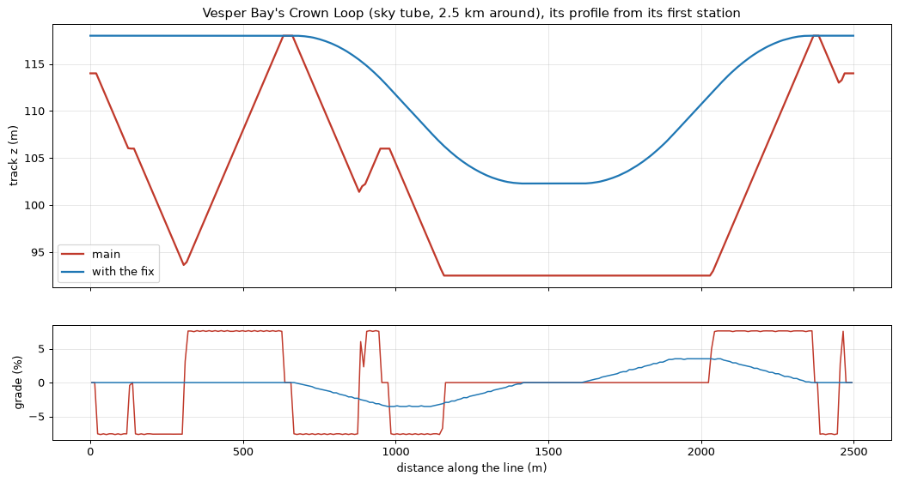

# Sky tube profile fix (#124)

A fix between milestones. Swagnik, looking at the gallery's sky tube picture: a tube curves up,
flattens, then curves up again. A sky tube should climb and descend in long smooth curves, not
in steps and humps.

## What was wrong

`transit.profile` gives each vertex of a line its needs: the base altitude, navigable water,
road decks, the buildings left under the line and the lines before it. `_profile_pass` then
lifts them to the lowest profile at 0.95 of the mode's `max_grade` (a sky tube's 8%, so 7.6%).
That max-plus envelope is piecewise linear with sharp kinks:
- it never fills the sag between two crests close together;
- it never rounds a grade change: the grade jumps between 0 and 7.6% within one 10 m vertex.

On main, Vesper Bay's Crown Loop (2.5 km around) pitches up and down at 7.6% six times. It dips
to 93.5 m and 101 m between crests, with 28 grade breaks of more than 1% over 10 m.

## What changed

`citygen/presets.py`, `citygen/transit.py`, `citygen/transit_checks.py`:

- **Per mode** (`ModePreset.design_grade`, `curve_m`, `fill_m`): sky tubes 3.5%, 300 m and
  500 m, with `max_grade` (8%) kept as the limit. The other modes have none, so their profiles
  are as before.
- **The profile** (`_curved`, after `_profile_pass`'s envelopes), the way M7's roads get their
  vertical curves:
  1. Every need is held level for half a curve and a vertex either side (a crest 300 m
     long), and every cap (a tower the tube passes through, a deck or line it passes under)
     likewise.
  2. Both are lifted and lowered at the design grade, 3.5%. Only where the two meet does the
     profile climb steeper, up to the limit grade.
  3. A closing by a level stretch of 500 m fills a sag between crests closer than that at the
     lower crest's height. A wider sag keeps a floor at least that long.
  4. A moving average over 300 m (`_box`, exact on the piecewise linear profile) makes every
     grade change a parabolic vertical curve 300 m long. Held level over a crest that long,
     the average stays over every need and under every cap.
  5. Last, the profile is clamped between the needs and caps lifted and lowered at the limit
     grade, exactly as before, so no need or cap can be missed.
- **Check** `transit_profile_smooth` (one more on every city with transit lines: 107 on a flat
  sample, 112 with decks). Measured every 10 m along a sky tube (around a loop, past its
  seam):
  - the grade changes no faster than a 300 m curve allows (two limit grades over it);
  - no sag is narrower than 200 m (the fill length less a curve, since the curves round a
    filled floor's ends).

## Choices

- **M7's way of making curves** (crests held level for half a curve, then a moving average)
  rather than fitting parabolas at each break. The breaks are too many and too close; an
  average joins overlapping curves by itself, and with the crests held level it cannot dip
  under a need.
- **Sky tubes only.** The other elevated modes go through the same envelope, but their humps
  are lower and shorter, and their lines run along the streets under more caps. Giving them
  curves would move every city's model; their presets can take it later.
- **3.5% design grade, 300 m curves, 500 m fill.** These are the middle of the issue's ranges.
  The design grade gives way to the limit only where a need and a cap leave no room. No sky
  tube in the sample cities needed it: every line keeps to 3.6% or less.
- **A closing for the sag fill.** It fills a sag between crests closer than 500 m at the
  lower crest's height, as the issue asks. A wider valley keeps a level floor at least 500 m
  long rather than a V. The Crown Loop's one valley comes down 16 m to such a floor, at
  102.3 m, rather than to the base altitude.
- **The check fails** (it does not only note). The generator meets it by construction except
  where it falls back on the clamp, and no city does.

## Results

Every city with a sky tube built on the final code, one at a time; every check passes:

| City | Checks | Try | Model |
|---|---|---|---|
| Vesper Bay | 107 | 1 | moves (the Crown Loop) |
| Delta Megacity | 107 | 1 | moves (Skyline Loop, Delta Loop) |
| Nexus City | 107 | 1 | the same bytes (the Spire Line runs level) |
| Greyhook | 107 | 2 | the same bytes (the Spine Tube runs level) |
| Vesper Bay Decks | 112 | 1 | moves (its Crown Loop) |
| Vesper Bay Pinned | 107 | 2 | (no recorded hash) |
| Vesper Bay Stacks | 107 | 2 | (no recorded hash) |

Each builds on the same try as on main. Greyhook's, the pinned demo's and the stack demo's
first tries fail checks that are not transit ones (`park_access`, `walkway_graph`;
`complexes`, `junction_placement`, `road_overlaps`, `walkway_building_clash`; `complexes`,
`prop_support`).

The sky tubes that climb, measured every 10 m:

| Line | Grade (main) | Grade (fix) | Sharpest grade change over 10 m (fix) | Sags under 200 m (main, fix) |
|---|---|---|---|---|
| Vesper Bay, Crown Loop | 7.7% | 3.5% | 0.003 | up to 7.4 m, none |
| Delta, Skyline Loop | | 3.6% | 0.002 | none |
| Delta, Delta Loop | | 3.6% | 0.002 | none |

**Stage 2** on Vesper Bay (`assetgen streets`, then `fit`): every street check passes; nothing
grounded off its surface, no clash, no transit through a building or a platform.
