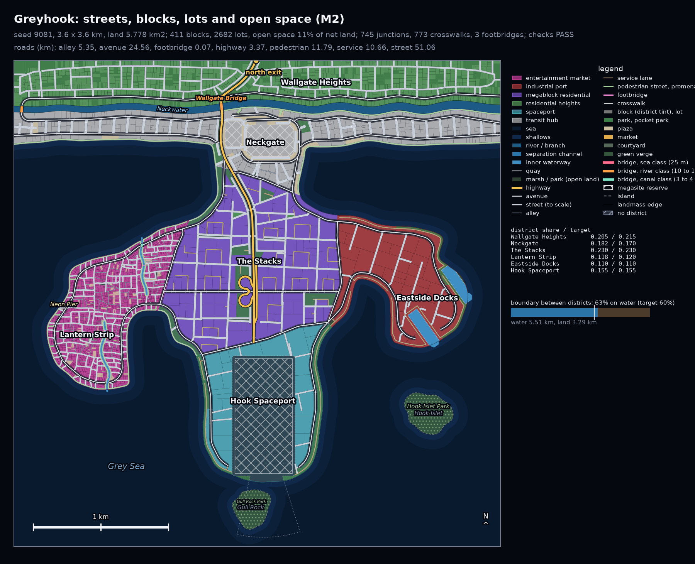
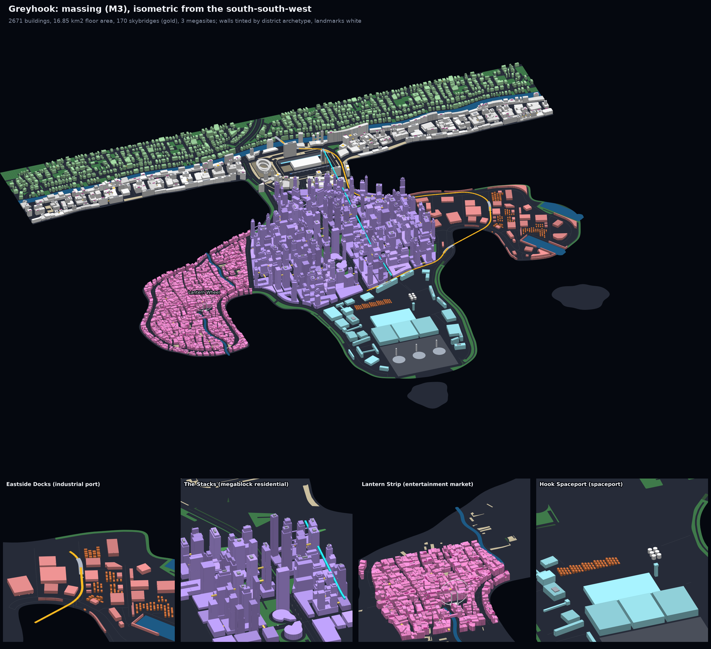

# Greyhook reshape

Greyhook's coastline is reshaped to be more natural and interesting: a peninsula that fans out
into headlands. A new spec option, `water.coast.headlands` (2 to 5, peninsula only), gives a
mainland strip, a short neck, then that many splayed headlands with a U-shaped cove between
each two. Greyhook (3.6 x 3.6 km) takes three: Lantern Strip on the west headland, Hook
Spaceport on the long middle one, Eastside Docks round the east cove, The Stacks on the body
where they meet, Neckgate and its arena at the neck, two islets (Gull Rock, Hook Islet) as
parks. The other cities are unchanged.

| Districts, streets and lots | Buildings |
|---|---|
|  |  |

- Build: `peninsula_city/` (every preview, `report.txt`, `trace.json`, `blockout_report.txt`,
  `render_top.jpg`, the 8K `render_iso_city.jpg`, `city.lock.json`), on main with M13 and
  M15. All 86 checks pass on the first full-city try.
- Shapes tried (`wip/`): three headlands with islets (kept), four headlands (Lantern Strip and
  the spaceport each spread over two lobes, the spaceport east of The Stacks), three headlands
  on a wider 4.0 km map (mostly more empty sea).
- The river runs close to the mainland coast with gentle bends (pinned, meander 0), so the
  walled heights north of it keep their share at every seed.
- The spine crosses the Neckwater on Wallgate Bridge beside the north exit: there is no room
  there for an immersed tube's approaches. The earlier layout, with its tube, is the test
  fixture `tests/data/peninsula_round_tip.json`.
- A fan peninsula's hydrology variants past 0 draw the fan afresh. The building height check
  now allows a building one floor under a flight-cone cap that sits less than a floor above
  its district's lowest height (as `buildings.floors_in` builds it; seed 27182 met it).

## Sweep

`citygen sweep --suite m8a --only peninsula_city --workers 4` ([`sweep.md`](sweep.md),
`sweep.json`), next to the `peninsula_city` rows of M10's sweep:

| seed | M10 | reshaped |
|---|---|---|
| 11 | pass, hv13 city x2 | pass, hv0 rv1 |
| 404 | pass, hv2 | pass, hv0 rv1 |
| 1999 | pass, hv11 | pass, hv14 |
| 3141 | pass, hv10 | pass, hv0 city x1 |
| 5077 | pass, hv13 | pass, hv1 city x1 |
| 8128 | pass, hv2 | pass, hv0 city x1 |
| 9081 | pass, hv0 | pass, hv0 |
| 27182 | pass, hv2 city x3 | pass, hv0 |

8 of 8 pass, as on M10; nothing newly failing. Full-city tries beyond the first: 5 on M10, 3
reshaped.
