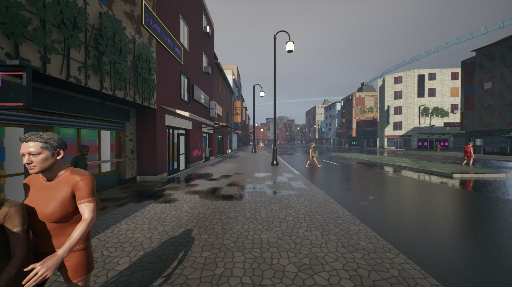
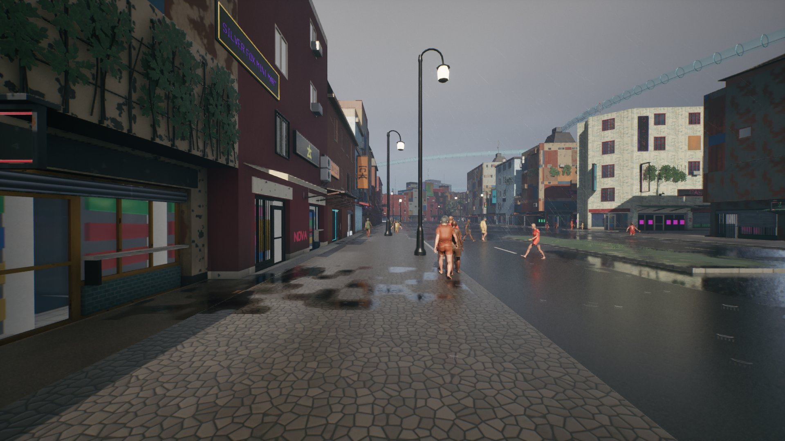
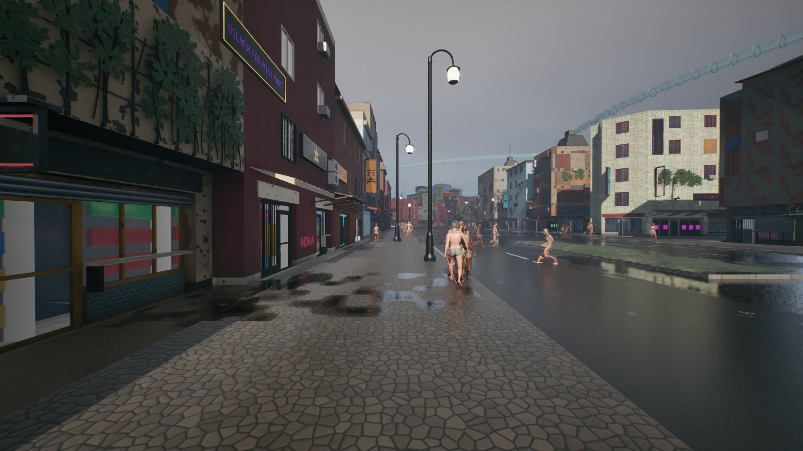
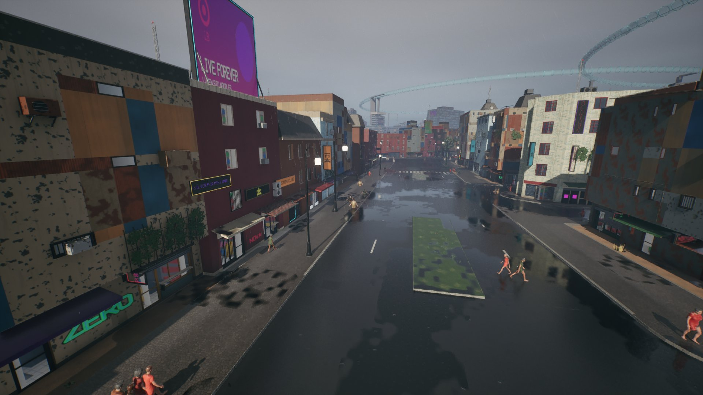
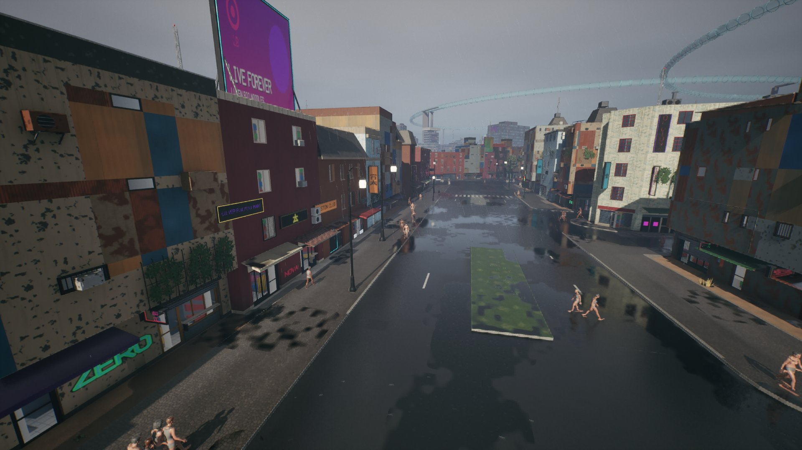
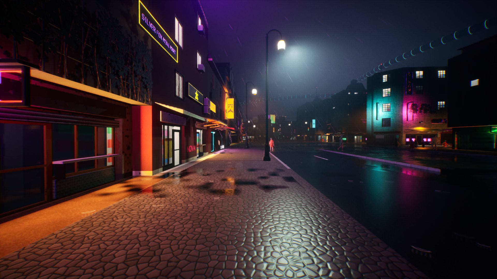
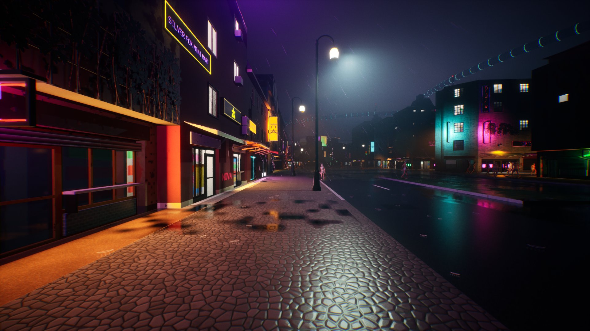

# The clothing switch (lifegen, a debug switch until LG2)

A switch that stops lifegen's people from drawing their clothes, so the bodies and the
walks can be judged without LG1's plain outfit, until LG2's generated garments are good.
On by default (the clothes drawn, as before). Built on the Windows PC on 2026-11-14, on main
after LG3 (#227).

## How to use it

- In the game, Tab, the developer menu's **Clothing** row (On or Off; shown when the level has
  lifegen's controller). `CityGen.MenuRow clothing` toggles it, `clothing=0` and `clothing=1`
  set it.
- The console: `CityGenLife.Clothing 0` (off), `CityGenLife.Clothing 1` (on), no argument
  toggles. `CityGenLife.Status` reports `clothing`, `hidden_material` and `whole_body` in its
  `library`.

## What it does per tier

The creator's assembled bodies have their triangles under the garments taken out (MetaHuman's
optimized assembly), and the mid meshes baked from them inherit the holes, so hiding the
garments alone shows arms, legs and a neck with nothing between them
([`holes_outfit_hidden.jpg`](holes_outfit_hidden.jpg), the first try). So, off:

| Tier | Clothing on | Clothing off |
|---|---|---|
| Near (30 m, at most 160) | the character's body, face, outfit and hair | the body and outfit hidden; MetaHuman's whole template body (`/MetaHumanCharacter/Body/IdentityTemplate/SKM_Body`, from the engine's MetaHuman plugin, on the same `metahuman_base_skel`) follows the body's pose in the character's own skin material; face and hair kept. The near tier reaches out to the mid tier's 90 m, still at most 160 people |
| Mid (to 90 m) | the baked walk | past the near cap only: the baked mesh's garment slots (the outfit's materials, found by the slots' names and the library's `UseInstanceTint`) drawn with `Core/Life/M_CgLifeHidden` (masked, draws nothing): the holes show there |
| Far (to 300 m) | the impostor cards | unchanged: the sheets were captured clothed; an unclothed sheet needs a library rebuild |

- **No library rebuild:** the whole body is the engine's template, read by path, and the
  hidden material is the importer's (`import_city.hidden_material`).
- **The template's shape:** one body for everyone (the character's bones move it, so heights
  and limb lengths follow the character, its build does not); a seam can show at the neck
  against the character's face.
- **Cost:** a debug view: with the clothes off, Old Town has the full 160 near people where
  it has 25 to 30 with them on (the status's `people_ms` 1.8 to 2.3 ms against 0.3 to 0.9).
  No benchmark: the switch is on by default and changes nothing then.

## Code

- `citygen/ue/CityGenLife`: `ACityGenLife::bClothing`, `SetClothing`, `ApplyClothing`,
  `SlotClothing`, `HiddenMaterial`, `WholeBody` (a follower skeletal mesh per near slot, made
  once; the hidden body still ticks its pose for its followers), `MidGarment`; console
  `CityGenLife.Clothing`.
- `citygen/ue/CityGenPlay`: the menu's Clothing row (`RowClothing`), `ClickMenuRow("clothing")`,
  the controller found by its class name (`GetLife`, `HasLifeClothing`, `GetLifeClothing`,
  `SetLifeClothing`), no link between the plugins.
- `citygen/ue/import_city.py`: `M_CgLifeHidden`, the actor's `hidden_material`, `whole_body`,
  `clothing` (`LIFE_VERSION` life4).
- `citygen/ue/check_city.py`: a play view named `*_noclothes` is shot twice, clothed
  (`*_clothes`) and not (through the menu row), the world's time held between, so both show
  the same people.

## In Unreal

Delta imported over its LG3 import in `CityAG16` (only the life controller changed: 1 actor
updated, 14,688 unchanged); `--check` passes (spawn, streaming, 505 of 507 traces down, 36
of 36 roofs, 35 of 36 facades, the walk and the curb, the flight, sky and time, air, weather,
look, far city, play features). Old Town by day, the same frame each pair:

| Clothing on | Clothing off |
|---|---|
|  |  |
|  |  |
|  |  |
|  |  |

The menu with its Clothing row: [`play_menu.jpg`](play_menu.jpg).

## Package

`C:/Users/swagn/CityGen/builds/packaged/Delta_lg3_fix1/Windows/CityAG16.exe` (Development,
Win64, 4.9 GB; `builds/packaged/package_lg3_fix1.cmd` from a copy of `CityAG16` without the
MetaHuman Character sources, as LG3's, cooked in 13 minutes). Its smoke launch (`-userdir=`
outside the package, no `Saved/` left in it) with `-ExecCmds="CityGen.MenuRow clothing=0"`
loads the level and the crowd with the switch off through the menu's row: the life status
says `"clothing":false,"hidden_material":true,"whole_body":true` (the template body cooked).
The packaging copy was deleted; `Delta_lg3` is kept.

## Open items

- The far cards keep their clothes (a second, unclothed impostor sheet would need the
  library's capture step again).
- Mid people past the 160 near cap show the holes (Old Town at its densest: 17 to 35 of them).
- The whole body is MetaHuman's template, not each character's build; the character's own
  whole body would need the library assembled without removing the hidden faces.
