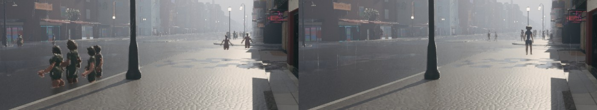
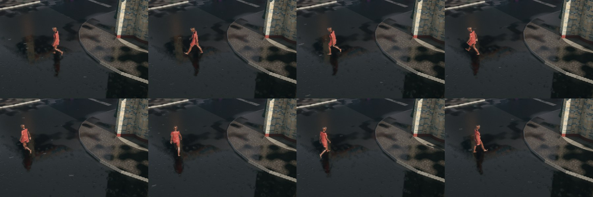
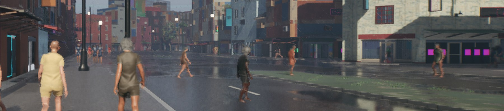
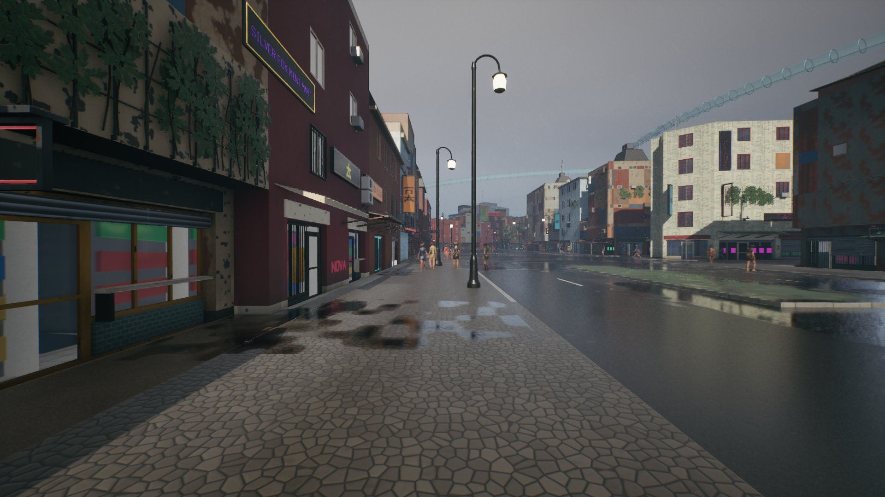
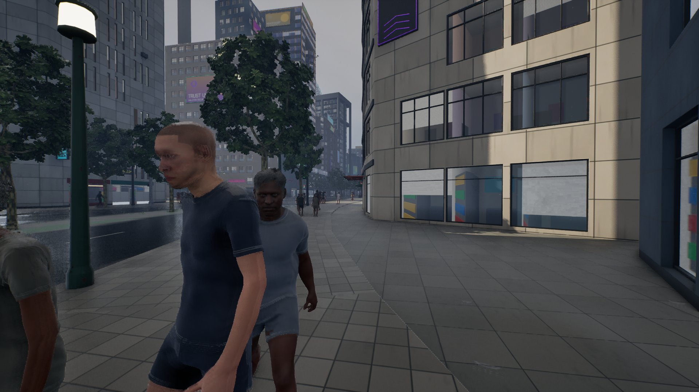
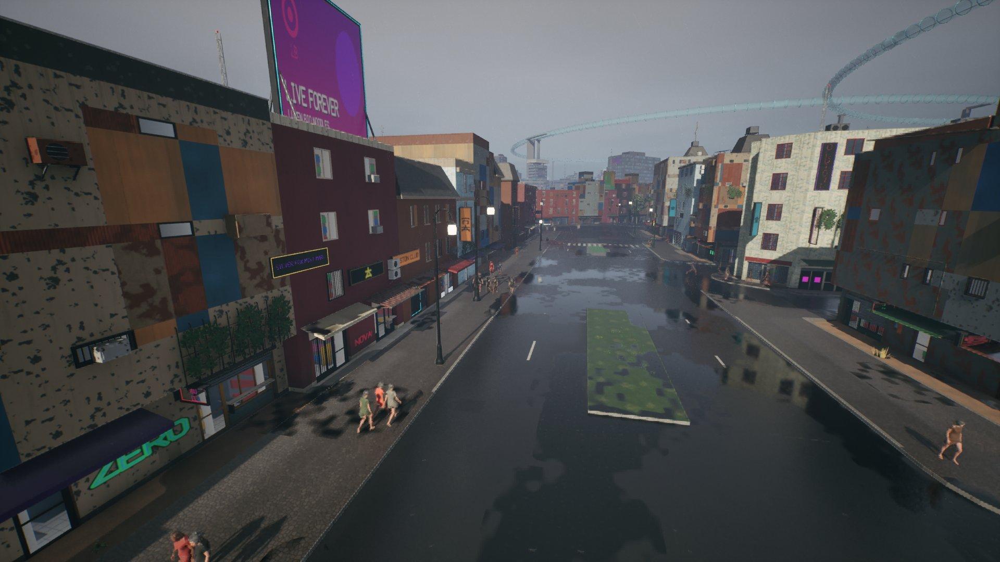

# lifegen's people fixes (after Swagnik's walk of the packaged Delta)

Three fixes to lifegen's people, for the whole city, from Swagnik's walk of the packaged Delta
(LG3 and the clothing switch, #228): people snapping to a new heading at corners, people past
about 30 m standing in a T-pose and seeming to walk through the road, and too many heavy
bodies. Built on the Windows PC (RTX 4070 Ti, 12700K, UE 5.8.4) on 2026-11-14, on main after
#228.

## What caused each, and what changed

| Problem | Cause | Fix |
|---|---|---|
| **Turning:** "they just teleport to the orientation change" | A person's heading was its walkway stretch's direction, so it snapped at every corner (inside a walkway and from one walkway to the next); its side offset was on that stretch's right, so at a corner it also jumped across the walkway (up to 1.2 m at a right angle), and on entering a walkway that runs the other way it jumped to the mirror side | Every corner rounded for walking (`CgLife::PathAt`): a quadratic curve over at most 1.5 m each way (0.45 of the shorter leg, cutting the corner by at most half the narrower walkway's half width, so people stay on it), between walkways too, the next walkway chosen 2 m before the end (`FCgLifeWalker::Next`) and the last one's heading kept after it (`PrevHead`); the side offset on the curve's right and kept on the walker's own right across walkways; the heading turned toward where the person goes (along the curve and toward the side it steps to) at most 270 degrees a second (`TurnTo`), at doors too. All three tiers draw that heading |
| **Far people:** T-pose past 30 m, "walk through the road", fixed only near | The mid tier (30 to 90 m, AnimToTexture baked walks) had **no bone textures**: LG1's library build baked them and saved the data asset and the mid materials, but never the three textures, so every editor session and package since sampled the engine's default texture: every mid person stood crouched, sunk to the knees in the pavement, arms out (`T_<id>_bone_*` missing on disk; `mid_before_after.jpg`). The impostor sheets were captured in the baking session, so the far cards were right. Two smaller faults on top: the bake ran twice the clip (AnimToTexture samples the clip's 121 keys at 15 fps: 8 s of a 4 s clip, the second half its last pose held), and a standing person's walk was frozen at a rate of 0 | `people_library.mid_mesh` saves the textures before the data asset and materials, bakes one loop of the clip (its custom range: 60 frames), and bakes again any mid mesh whose data asset names no texture; the library rebuilt in CityAG16 (`citygen unreal ... --people`: clips, mid meshes and sheets again, the characters kept, no cloud call), new cache `~/.cache/cybergen/people/1de3e256eff2a119`. The runtime plays each character's loop as the clip's length (`MakeMidLoops`, so an older bake plays right too) and holds a standing person in the walk's passing pose, found from the clip's thighs (frame 33), its card in the sheet's cell nearest it (`LookData`) |
| **Body builds:** "too many fat people" | Six of the library's 24 characters come from MetaHuman presets with heavy bodies (waist over height, measured on the assembled characters: Bo 0.70, Bruce 0.65, Dominic 0.69, Jorge 0.86, Orlando 0.60, Lani 0.57, against 0.37 to 0.53 for the other 18): 26% of every crowd, five of the twelve men | The crowd draws a character by its preset's weight (`presets.BODY_WEIGHT`, `plan.draw_person`): heavy builds 4.9% of Delta's pool (25.6% before), all 24 characters still drawn. Reweighting was enough (19 characters at full weight); the library and its hash are unchanged by it (kept out of `library.py`) |

"Walking through the road" has a second part this does not change: the walkway graph's
crossings. Delta's crossing walkways (unmarked crossings at junctions) run 34% of their
length on a carriageway and crosswalks 29% (`walk_in_road.py` in the session's scratch);
people crossing an avenue at an unmarked junction crossing are on the graph, and the corner
tails that run up to 25 m along the curb are LG3's citygen open item. In the shots after the
fix the people on the carriageway are on such crossings, near and far alike.

## Shots (Delta, CityAG16, by day)

| Mid people (all forced mid) before and after the library rebuild | Turning at a junction: 8 frames 0.3 s apart |
|---|---|
|  |  |
| **Mid people at 30 to 90 m (85 mm), the default tiers** | **The same street, everyone mid** |
|  |  |
| **A Midtown sidewalk: the body mix** | **Old Town from 9 m** |
|  |  |

More in `unreal/`: the far street (135 mm), the junction with everyone mid, the view before.
The check's views can now run console commands per view (`$CITYGEN_UE_VIEW_CMDS`, a JSON
object of view names and commands, `<name>@after` after the shot) and shoot a short sequence
(`*_seq<N>`, the world slowed to `$CITYGEN_UE_SEQ_DILATION` between shots), which made these.
Every check passes (spawn, streaming, collision, the walk and the curb, the flight, sky and
time, air, weather, look, far city, play features).

## Benchmark

The lean route at native 2560 x 1440, one run, no DLSS pass (`bench/final/`):

| pass | p95 all | walk | drive | fly | game p95 (all) | game p95 (walk) | draws p50 (walk) |
|---|---|---|---|---|---|---|---|
| **`night_plan_all`** | **19.5** | 23.1 | 19.4 | 18.3 | 17.4 | 22.7 | 1,617 |
| `night_life` | 19.1 | 21.2 | 19.1 | 18.3 | 16.8 | 20.5 | 1,605 |
| LG3's `night_plan_all` | 19.3 | 21.4 | 19.3 | 18.5 | 16.9 | 20.5 | 1,618 |

- **Within the budget:** 19.5 ms p95 over the route against decision 7's 20 ms, 0.2 ms over
  LG3's; no tuning round. The walk is over it as in LG3 (23.1 ms against 21.4, the game
  thread's; one run, and this run's two passes, the same people, are 1.9 ms apart on it). The
  corner rounding and turning show no cost of their own in the controller's people time
  (`people_ms` 0.2 to 1.1 ms in the check's views, as in LG3).
- **Not flagged:** the foreground kept, other processes under one core.

## Package

PACKAGE

## Tests

- `tests/lifegen/` and `tests/test_unreal_play.py` (32, all pass; log
  `builds/people_fixes/tests2.log`): a new `test_crowd_draws_heavy_builds_rarely`. The C++ is
  checked by the plugin's build and the check above (no unit tests of its own).

## Open items

- **Crossings on the carriageway:** the walkway graph's crossing and crosswalk tails along the
  curb (LG3's open item, citygen's).
- **Idles mid and far:** a standing person far off holds the walk's passing pose; an idle baked
  next to the walk would need the mid frames' format to carry a second range.
- **The character mix:** six presets drawn rarely; a library with more slim and average bodies
  would need new characters (Epic's cloud rigging).
