# People idling and sitting down (people_idles)

Built on the Windows PC (2026-11-17), on main after the HLOD streaming fix (#240). People
standing or sitting still now look alive at every distance, and a person going to a bench sits
down and later stands up and walks off. Only Unreal's own animation (the user's Game Animation
Sample, read only, copied into the project by the existing step); nothing of Epic's or
MetaHuman's in the repo; no cloud call. The people library (`5279ccbf5d436abe`) is untouched:
its hash, cache and assets are as they were.

| Part | Where | What |
|---|---|---|
| The bench's transitions | `lifegen/presets.py` `PLACE_CLIPS`, `SIT_IN`; `citygen/ue/people_places.py` `seat_frame` | the sample's sit-downs from the front, the left, the right and behind on either side (the left foot leading) and its stand-up (`out_to_walk`), retargeted with the library's retargeter, made in the seat's frame |
| The mid idles | `people_places.py` `loop_window`, `mid_bake`; `citygen/unreal_people.py` `IDLE_BAKE`, `idle_key` | per look a second AnimToTexture bake beside the library's: its walk, then a standing idle and the bench's sitting loop over their best loops; material instances reading it |
| The far still cells | `people_places.py` `capture_sheet`, `card_material` | per look a sheet of 16 rows (the walk's 8, 4 sitting poses, 4 standing) on a card that holds a cell |
| Exporter | `citygen/unreal_life.py` `idle_data`; `import_city.people_assets`, `places_props` (`LIFE_VERSION` life11) | the controller's `MidStillFrames`, `MidIdleMaterials`, `MidIdleStarts`, `CardCells`, `SitInClips`, `SitInCount`, `SitIn`, `SitInStart`, `SitOutClips`, `SitOut` |
| Runtime | `CityGenLifeProcessors.cpp` (`StepSlot`, `PickSitDown`, `SitAnim`), `CityGenLifePeople.cpp` (`LookData`, `MakePeople`, `UpdatePeople`), `CityGenLifePlaces.cpp` (`MakeSitFrames`, `ShowPlace`), `CityGenLifeTypes.h` (`CgAnim::SitDown`, `StandUp`, `IsSit`; `CgLook`) | the walk to a sit-down's start, the seat held through the transitions, near clips played once, mid and far looks by what a person does |
| Docs | `docs/unreal_export.md` ("People idling and sitting down"), `docs/lifegen_milestones.md` | |

## How it works

- **Sitting down near.** A person going to a bench point picks the sit-down whose start lies
  most nearly the way it comes from (never one starting behind the bench, where a wall or a
  building may stand), walks to that start, turning to its facing over the last meter, then
  stands on the seat facing the seat's way while the sit-down plays from where its stretch
  starts; the sitting loop follows from its first frame, where the sit-down ends. The
  sample's sit-downs walk up from 4 to 4.7 m off the bench and its stand-up walks 5.9 m away,
  so a person plays only the stretch within 1.3 m of the seat (the sit-downs' last 9 to 9.9 s,
  the stand-up's first 2 s) and walks the rest itself: it never starts or ends in the road in
  front of a bench. When its stay is over it stands up on the seat and walks off from where
  the stand-up ends. A near slot taken mid-way plays the clip from where the walk processor's
  clock has it.
- **Mid (30 to 90 m).** Each look's second bake holds the library's walk (frames 0 to 59, as
  the library's), the library's `idle_relaxed` (5 s, frames 60 to 134; the clip repeats at
  5 s) and the bench's sitting loop (the 5.2 s stretch from 1.5 s that loops best, frames
  135 to 212; summed bone turn 0.13 rad across the seam). A mid person standing still plays
  the idle, one sitting the sitting loop, each from its own time offset and at 0.85 to 1.15
  of the clip's pace. With the bakes a sitter is drawn by its tier; LG4 kept sitters near out
  to 90 m because the mid tier had no sitting pose.
- **Far (90 to 300 m).** Each look's still sheet repeats the library's 8 walk rows and adds 4
  poses through the sitting loop and 4 through the idle; a sitting or standing far person
  holds one of them, its own by its seed.
- **The far cards were upside down** since LG1: the library's card material maps the plane's
  v against the card's height, so every cell was drawn on its head (unseen at 90 to 300 m,
  plain in LG2's all-far shot, `docs/progress/LG2/unreal/pday_allfar_close.jpg`). The still
  card reads the cells upright and replaces the library's card for every far person.

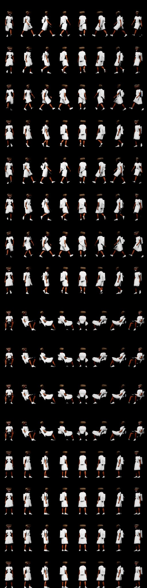

## Shots (Delta, by day)

The transitions: `CityGenLife.PlaceShow sitdown|standup` moved the camera to someone who had
just begun (the check's `until`), four shots with the world slowed to a quarter between them.

| Sitting down (Midtown) | Standing up and walking off (Midtown) |
|---|---|
| 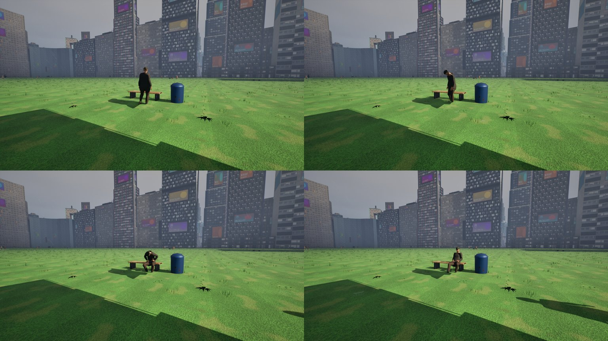 | 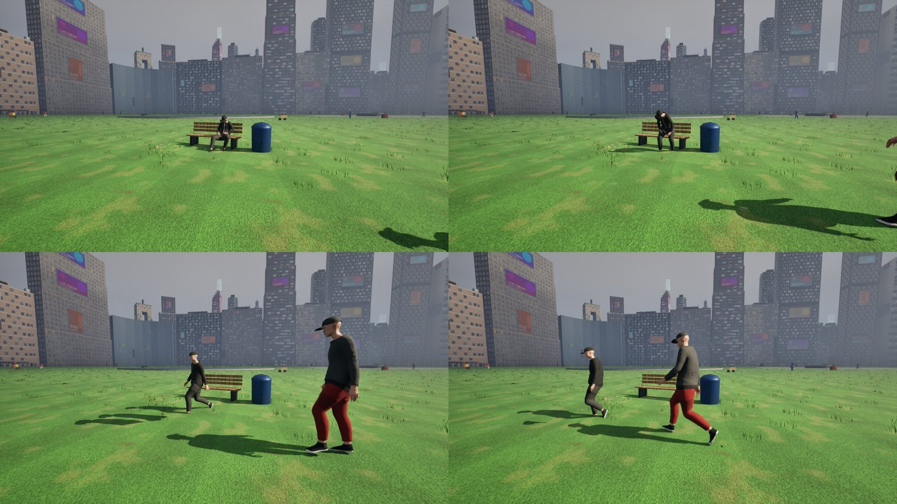 |
| **Sitting down (Old Town)** | **Standing up (Old Town)** |
| 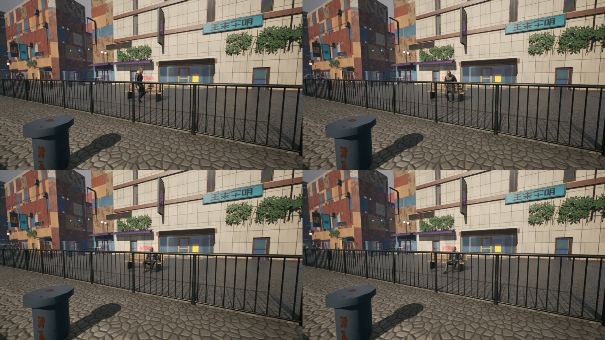 | 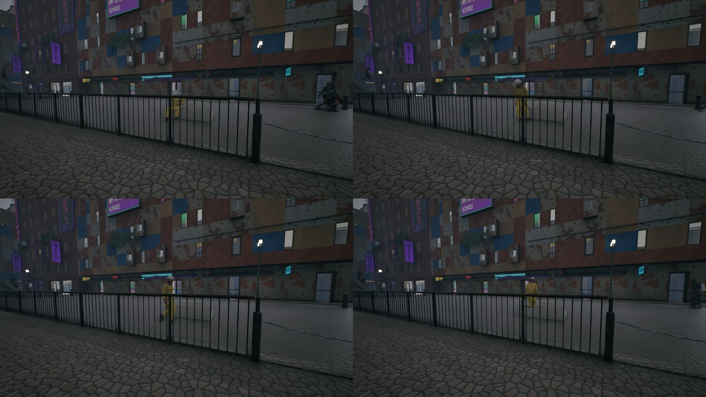 |

Mid and far people seen close: the views drew everyone by one tier (`CityGenLife.Tiers 0 0 90
300` for mid, `0 0 0 300` for far), the same person near for the comparison.

| Mid: sitting on a bench | Mid: standing at a shop door | The same, near |
|---|---|---|
| 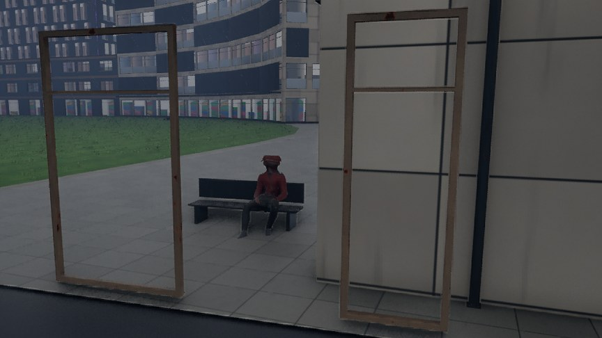 | 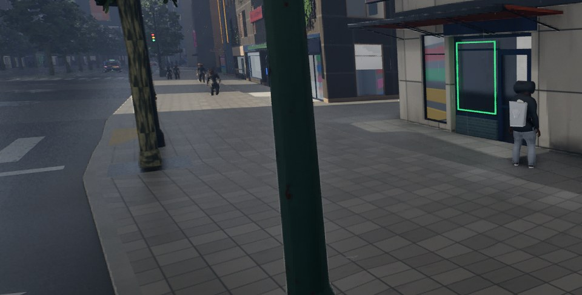 | 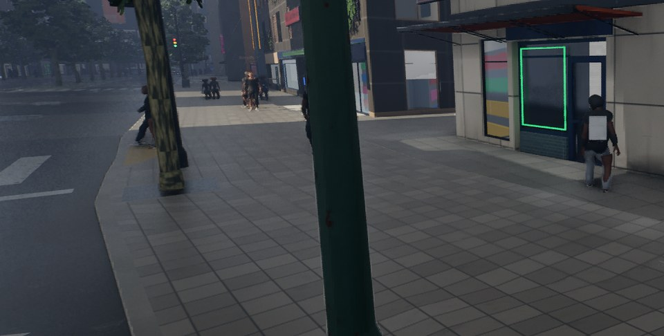 |
| **Mid: a ring at a slot in Old Town, sunk into the sidewalk** | **The same, near (an older fault, below)** | **Far: sitting (a still cell) and walking** |
| 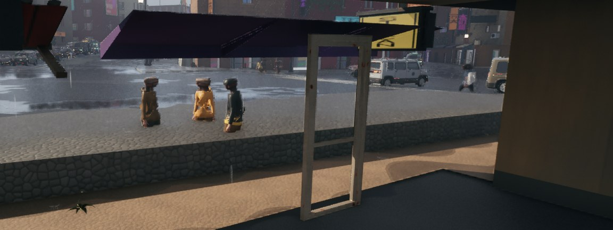 | 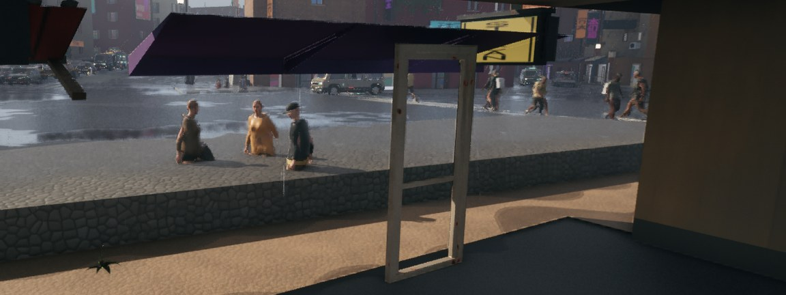 | 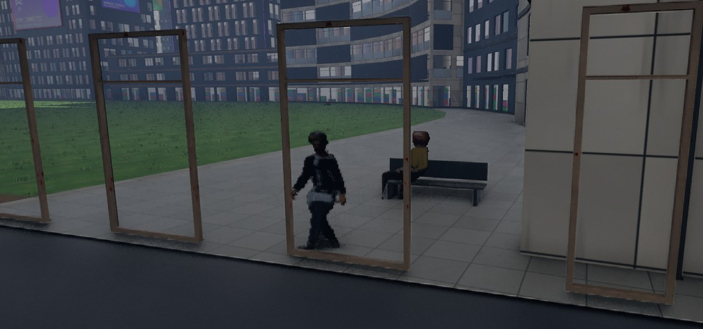 |

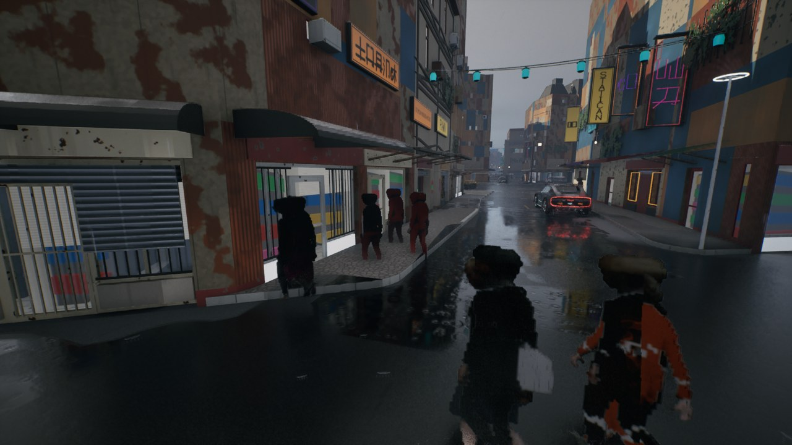

## Build, import and check

- **The places' clips step** (`unreal_people.ensure_place_clips`, run by `--people`): the
  sample's six bench clips copied in from the user's sample (its closure, read only), then
  three editor runs of 48 looks each (25 minutes: retargets, 144 bakes and 144 sheets); later
  runs that change only the script keep the bakes and sheets (`cg.idles`, the key of the
  library's hash and `IDLE_BAKE`) and take about a minute. On disk: `MidIdle` 94 MB, `FarIdle`
  85 MB in the project.
- **Delta** imported again into `CityAG16` (`citygen unreal ... --people`; the life
  controller updated, 13 minutes with the HLOD pass, nothing missing); `--check` passes three
  times (spawn, streaming, collision, the walk and the curb, sky and time, air, weather, look,
  far city, play features, the flight), the status's `places` with `sit_downs` 5,
  `mid_idles` and `still_cards` true.

## Benchmark

The lean route, one run, native 2560 x 1440, no DLSS pass
([`bench/bench.md`](bench/bench.md)); not flagged (the foreground held, 2.5 cores of other
load: a Python process and OneDrive's sync).

| Pass | all p95 | walk | drive | fly | game p95 | hitches > 50 / > 100 ms |
|---|---|---|---|---|---|---|
| `night_plan_all` | **19.2** | 21.1 | 20.4 | 17.0 | 17.7 | 36 / 11 |
| `night_life_noplaces` | 18.0 | 18.3 | 19.5 | 16.4 | 15.2 | 20 / 7 |
| `night_plan_all` after #240 | 18.8 | 20.5 | 19.6 | 16.4 | 17.4 | 19 / 5 |

Under the 20 ms budget by 0.8 ms (no second run). Places off saves 1.2 ms over the route
(LG4 measured 0.3 ms on its build), and the run had more hitches and longer loads after the
teleports (17.9 s against 7.6 s) than #240's; a single run under 2.5 cores of other load, so
neither was looked into further (the budget holds).

## The package

Delta cooked and packaged (Development, Win64) from `CityAG16` as before, staged only and
moved to `builds/packaged/Delta_idles` (`package_idles.cmd`). `builds/packaged/Delta_hlod` was
deleted before the cook (the disk had 13 GB free).

## Tests

`tests/lifegen/` (every file, the exporter's people, places, transit, air and water, weather
and clothing packing) and `tests/test_unreal.py` but its two Unreal import cases (Delta's
import and checks above cover the importer): 121 passed (log
`builds/people_idles/tests/tests.log`). New: `test_exporter_packs_the_idles`,
`test_places_hash_and_idle_key`, `test_places_need_a_library`.

## Choices made

- **Sit-downs from five sides, the left foot leading** (the sample has a right-foot twin of
  each): which foot leads would need the walk's phase at arrival; five sides cover the ways
  people come.
- **Only the stretch near the seat played** (1.3 m): the sample's clips walk 4 to 6 m, which in
  front of a bench by a road would start a sitter in the carriageway.
- **The stand-up walks off** (`out_to_walk`, not `out_to_stand`): people leave a bench walking.
- **A second bake beside the library's**, not a library rebuild: the library's hash, cache and
  assets stay; the bake key moves only with `IDLE_BAKE`.
- **One idle for the mid tier** (`idle_relaxed`) and **4 + 4 still cells for the far tier**:
  at 30 to 300 m one idle per person, each at its own phase and pace, reads as alive; more
  rows would grow every sheet.
- **The transitions' offsets are the first clip group's** in the walk processor (the library
  has one group; groups differ only by their bodies' proportions).

## Open items

- **No blending** between clips near: the sitting loop's pose where a stand-up begins is not
  the stand-up's first pose (a small pop as a person rises); single node animation has no
  crossfade.
- **Mid and far people mid-transition** show the sitting loop at the seat while a near one
  sits down (a person who comes near during a sit-down plays it from where it is).
- **Seats by prop kind, not variant** (LG4's open item): the sit-downs end on the slot's point;
  a bench variant's seat may sit a few centimeters off it.
- **People at a slot sunk into a raised sidewalk** (found in these shots, not this change's: near
  and mid agree): a ring of three at a slot in Old Town, on a sidewalk raised about a meter over
  the pavement beside it, stood to their hips in it. A slot's point takes its walkway lane's
  height at its distance (LG4, `BuildPlaces`); why it is low there was not looked into.
- **The places' cost** measured 1.2 ms over the route (0.3 ms in LG4) and the loads after the
  teleports were longer, in one run under other load; within the budget, not tuned.
