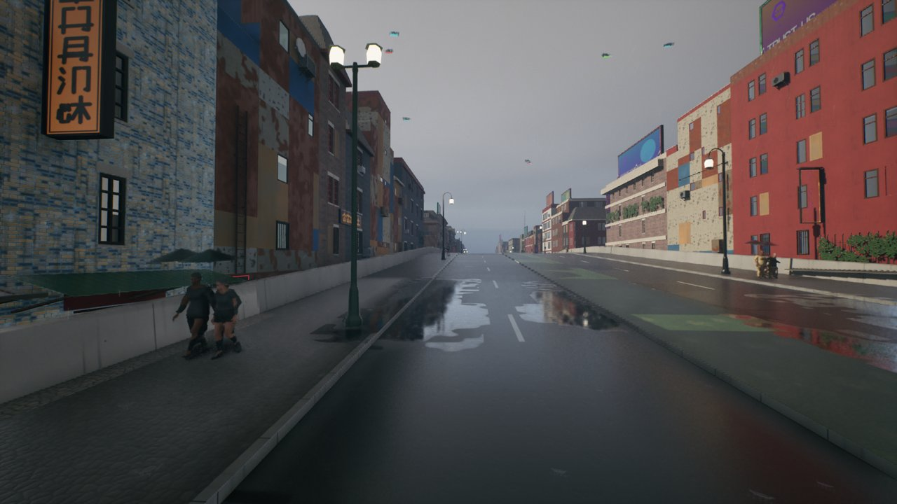
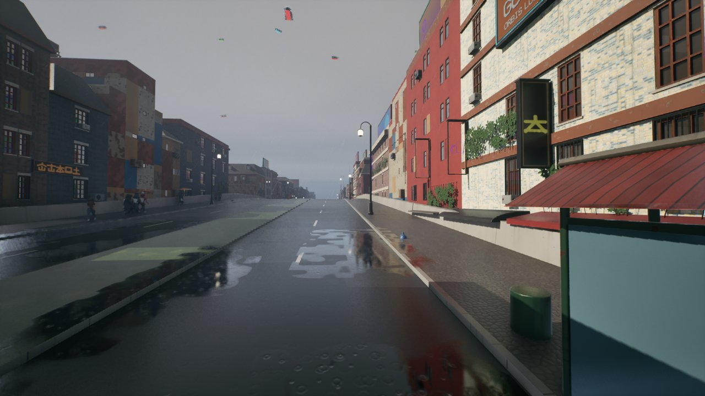
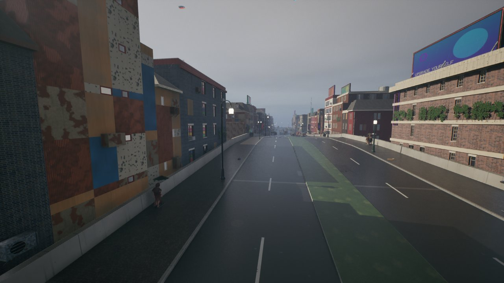
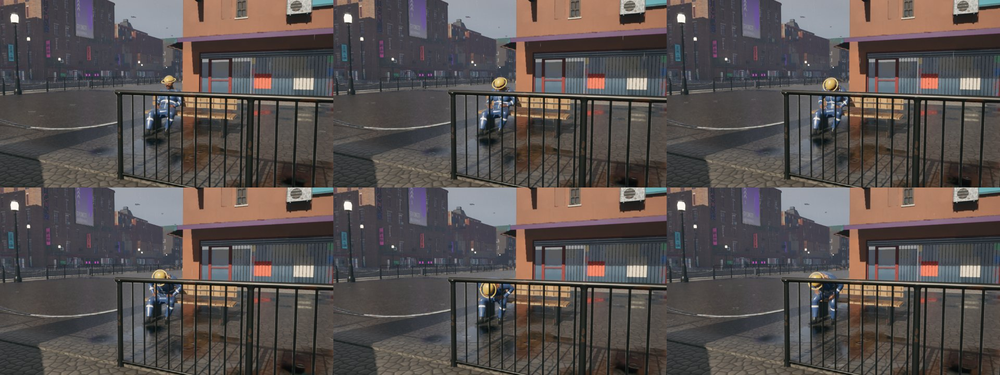
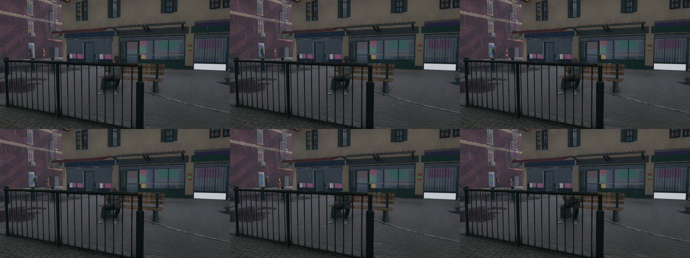
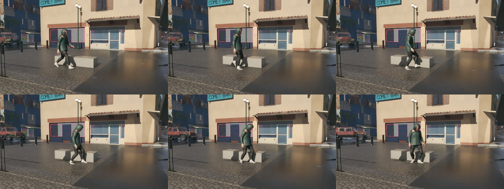
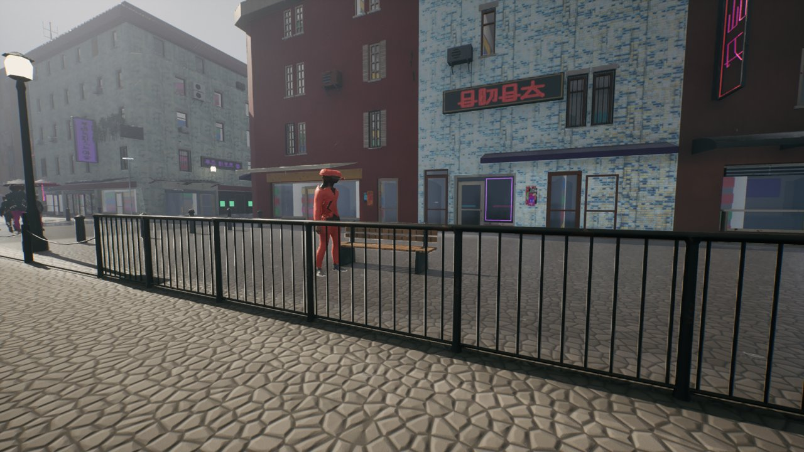
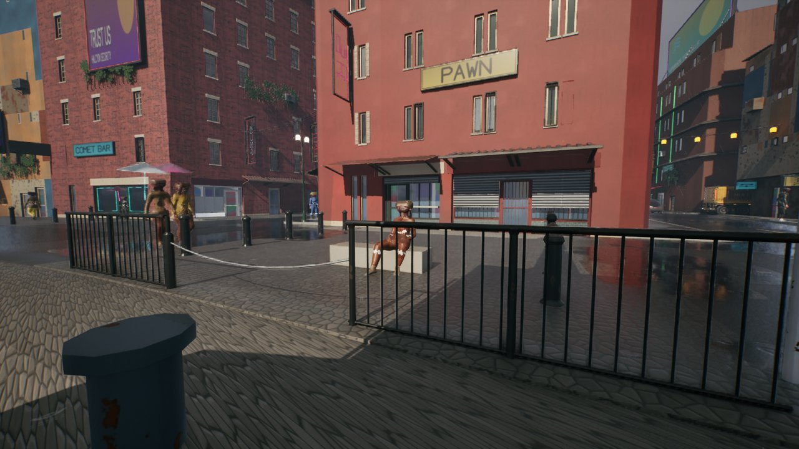
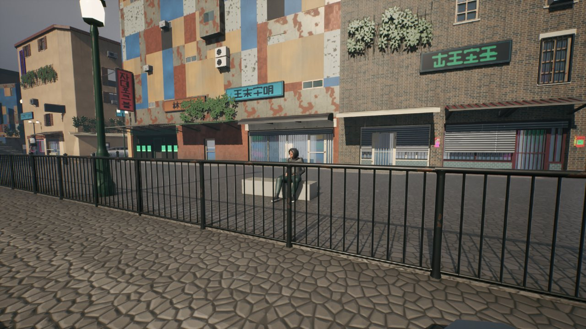
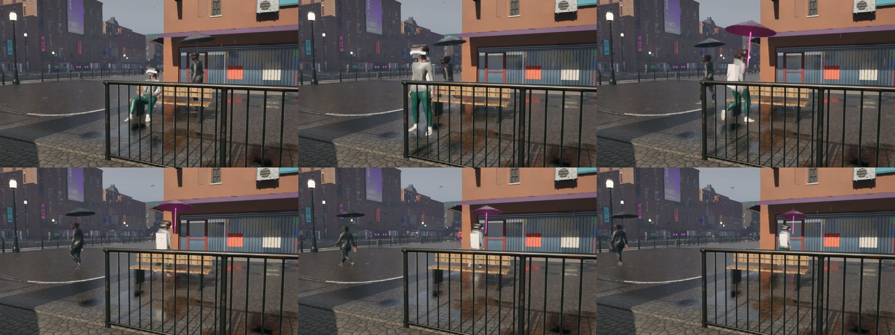

# People on their surfaces (people_surfaces)

Built on the Windows PC (2026-11-17), on main after the Delta rebuild (#243). Three faults of
the people near and far from Swagnik's walks, fixed in the exporter and the life runtime; the
live Delta build (`builds/delta_main`) had only its `graphs.json` written again and its life plan
made again, then was imported, checked, benchmarked and packaged.

| Part | Where | What |
|---|---|---|
| Walkways on the surface | `citygen/walksurf.py` (new), `citygen/exports.py` (`graphs`, `walk_surface`), `citygen/unreal.py` (`flat_graphs`), `lifegen/plan.py` (`walk_heights`) | every walkway drawn on M22's pavement map on the surface AG17 draws, with a point wherever that surface bends; check `walk_heights` |
| Blended clips near | `CityGenLifeAnim.h`, `CityGenLifeAnim.cpp` (new: `UCgPersonAnim`), `CityGenLifePeople.cpp` (`Assign`, `UpdatePeople`), `CityGenLifeActor.h` (`ClipBlendS`, `SitBlendS`), `CityGenLifeModule.cpp` (`CityGenLife.Blend`) | a crossfade between a near person's clips, the clip before carried from where the body stood |
| Mid and far in step | `CityGenLifePlaces.cpp` (`MakeSitFrames`: `SitSeatedS`, `SitRiseS`), `CityGenLifePeople.cpp` (`UpdatePeople`) | mid and far sitters stand at the sit-down's start until near would be seated, at the stand-up's end once up |
| Docs | `docs/unreal_export.md` ("People on their surfaces", the record), `CLAUDE.md` | |

## Fault 1: people inside a road's hump

**Why.** The model keeps a walkway's height at its vertices only, and a raised road's sidewalks,
crossings and the paths to them at the ground (M7). The exporter's `graphs.json` took those
lines as they were; AG7's street pieces put a raised road's sidewalk lines on its deck, but at
the same vertices. A lane drawn from a line runs straight between its points, so wherever a
road's profile bends between two vertices the lane runs under or over the drawn sidewalk. Near
people trace the ground and stood on it (late, between traces); mid people keep the ground offset
they last traced near and follow the lane: on Delta's Old Town avenue, which rises 4.5 m to a
bridge over a canal, its west sidewalk ran from 0.2 m at one end to 0.2 m at the other, its
people walking up to 4.5 m inside the bridge's approach. A raised road's crossings and crosswalks
ran at the ground under it (a crossing of a 1.45 m embankment road at 0 m; a crosswalk across a
1.5 m junction at 0 m).

Measured on Delta against the surface as AG17 draws it (every 2 m along every sidewalk lane
Unreal walked): 9,744 of 10,168 sidewalks 0.2 to 0.25 m under their top (the sidewalk's curb
lift, the model's z at the ground), and 31 more than 2 m off, up to 10.5 m.

**Fix.** `citygen/walksurf.py` drapes every walkway drawn on the pavement map (sidewalks,
crossings, crosswalks, alleys, promenades, pedestrian streets, footbridges, paths) on the surface
AG17 draws: M22's faces at their vertices' heights by mean value coordinates (`pavement.mvc`, as
AG17's samples inside a face), lifted as AG17 lifts them (curb, sidewalk, corner pad, median
0.2 m, the rest 0.05 m). Where faces overlap in plan (a sidewalk under a viaduct, a road over a
street) a walkway along a road takes the face nearest its road's own profile there plus 0.2 m,
any other the face nearest its own height, within 1.5 m. Walkways not along a road follow those
they join: their height moved by the difference at their ends, linearly along them (so a
crossing of a raised road climbs onto it with its sidewalks, a door's path rises to a raised
sidewalk; an end on nothing draped keeps its height), and ends that meet take one height. Each
line is sampled every meter and a sample kept where the line through its neighbours misses it by
2 cm (every vertex kept in place). `exports.graphs` writes the draped lines and `walk_surface`
1; `unreal.flat_graphs` takes these over AG7's lines, so the data assets, the life packs, the
check's walk and the benchmark's route all get them.

On Delta: 19,642 walkways draped in 13 s, 81,343 points to 92,742. The Old Town sidewalk now
climbs to 4.69 m at the crest in 16 points. lifegen's new check `walk_heights` measures the
lines every 0.5 m against the surface: all within 5 cm but 8 (at most 0.15 m: a door path's
curb crossing, a dip of a few centimeters between two faces), 56,267 samples left out where the
surface steps (curbs, which a line rounds off over a meter); it fails a line 0.25 m off.

**AG7's lines dropped.** AG7's raised-road sidewalk lines (360 walkways, 2,418 vertices) agree
with the draped lines within 1 cm at 2,049 vertices; at 121 they are 0.3 m or more off (up to
3 m). There the vertex lies in a junction's corner pad, not on the sidewalk piece's own faces,
and AG7 falls back to its road's profile at the projected station, carried past the road's end
(1.85 m where the corner pad is drawn at 0.57 m). The draped line takes the corner pad.

The avenue's south approach to its bridge (the sidewalks rising from 0.2 m to 4.7 m), seen from
3.5 m up at its foot, every person near (out to 90 m) or every person mid:

| Near, west sidewalk | Mid, east looking at the west sidewalk |
|---|---|
|  |  |

From 9 m up over the approach: people at the crest on its sidewalks, near and mid.

| Near | Mid |
|---|---|
|  |  |

## Fault 2: sitters popping as they rise

**Why.** Near people's bodies played their clips as a single node (LG1): one clip at a time,
switched at once. A sitter's sitting loop, at any frame, met the stand-up's first pose with no
blend, a pop as the person rose; a walker met a sit-down's first pose the same way.

**Fix.** `UCgPersonAnim`, a native animation instance in place of the single node: one clip
looping or once at a rate from a position, as before, crossfading over a blend (eased) from the
clip before, which keeps playing through it. A sit-down and the stand-up play in the seat's frame
(the mesh moves to the seat as one begins), so the clip before is carried on its root bone from
where the body stood (`RootFix`, the old component transform in the new one's frame) and fades
out there. 0.3 s between walking, standing, talking, running and into a sit-down
(`ClipBlendS`); 0.5 s from a sit-down into the sitting loop and from the loop into the stand-up
(`SitBlendS`); none for someone just come near. The body's pose now ticks after the controller
(a tick prerequisite), so a clip asked for and the move to a seat show in the same frame.
`CityGenLife.Blend 0 0` gives the old switch.

| Standing up, blended (six frames, the world at 0.05) | The same with `CityGenLife.Blend 0 0` |
|---|---|
|  |  |

## Fault 3: mid and far sitting before near

**Why.** A mid or far person at a bench showed the sitting loop (a still sitting cell far off)
from the moment it reached the seat, whatever it was doing: near, the same person stands up from
1.3 m in front of the bench and sits down over the sit-down's 9 to 10 s, and stands up over the
stand-up.

**Fix.** `MakeSitFrames` finds when each sit-down has the person seated and when the stand-up
has it up: half way between the clip's two pelvis heights over the stretch a person plays (the
clips' root is at the seat, the pelvis carries their travel). On Delta's clips: seated 1.77,
1.67, 1.70, 2.33 and 2.30 s after the five sit-downs begin, up 1.07 s into the stand-up. Mid and
far stand (the baked idle, a standing cell) at the sit-down's start until then, sit, and stand at
the stand-up's end once up (`UpdatePeople`).

| Mid, a sit-down just begun | Mid, 5 s later | Near, 5 s after a sit-down began |
|---|---|---|
|  |  |  |

A mid sitter standing up (six frames about 1 s apart, the world at 0.3): seated, then standing
where the stand-up ends, then walking off.

## Import, check

- **Delta's graphs and plan:** `graphs.json` written again from the city model
  (`builds/surfaces_tmp/regraph.py`, as `citygen blockout` writes it, no Blender; 13 s);
  `lifegen plan --atmos` again (62 s, 37 of 37 checks, `walk_heights` new).
- **Import** (`citygen unreal ... --people --atmos --life --dlss`): the plugins built (the new
  anim instance), actors 0 created, 3 updated (the life controller, the graphs), 14,511
  unchanged; no mesh imported; the HLOD pass found nothing to build; 12 minutes.
- **`--check`: PASS** (spawn, streaming, collision 505 of 507 traces, 36 of 36 roofs, the walk
  and the curb, sky and time, air, weather, look, far city, play features, the flight), twice:
  once for each set of the shots above (`builds/surfaces_tmp/views*.txt`, `view_cmds*.json`; the
  second with `CITYGEN_UE_SEQ_DILATION` 0.3 for the mid stand-up).

## Benchmark

The lean route, one run, native 2560 x 1440, no DLSS pass ([`bench/bench.md`](bench/bench.md)).
It ran beside another session's pytest (about 1 core: 1.55 cores of other load on average, 2.4
at most) without waiting for the machine to go idle; not flagged (the foreground held, nothing
starved).

| Pass | all p95 | walk | drive | fly | game p95 | hitches > 50 / > 100 ms | loads |
|---|---|---|---|---|---|---|---|
| `night_plan_all` | **18.8** | 20.1 | 19.5 | 17.0 | 16.1 | 22 / 5 | 13.4 s |
| `night_plan_all`, delta_rebuild | 18.0 | 19.3 | 18.7 | 16.6 | 15.9 | 15 / 4 | 14.2 s |

Under the 20 ms budget by 1.2 ms (no second run). 0.8 ms over delta_rebuild's run, within a
run's noise under a core more of other load; the anim instance samples one clip a near person
as the single node did, two only through a blend.

## Tests

Only what changed (logs in `builds/surfaces_tmp/tests/`):

- `tests/test_walksurf.py` (new): 4 passed (a sidewalk over a 4.5 m hump follows it between its
  vertices and not a deck over it; a crossing of the raised road climbs onto it with its
  sidewalks and a door's path up to it, ends meeting at one height; the check; lifegen's
  `walk_heights` on a graphs.json draped, not draped and from before).
- `tests/test_unreal.py` (but its two Unreal import cases) and
  `tests/test_blockout.py::test_graphs_and_props`: 44 passed, 1 failed. New
  `test_graphs_carry_the_draped_walkways`; `test_stage2_layer` (graphs.json's draped lines over
  stage 2's, stage 2's over a graphs.json from before) and `test_terrain_city` (the draped lines
  with the ground added) changed. The failure, `test_district_regeneration_changes_only_its_
  neighborhood`, is in blockout objects (`city.road_street.t+00-04`, `city.sidewalk.t+00-04`, a
  tile far from the regenerated district), which this change does not touch (`blockout.
  make_plan`, not the graphs): it predates this branch (the regeneration of the small city
  after the road curves, #239; not looked into here).

## Choices made

- **Draping in the exporter, from the pavement map**, not by AG7's pieces: every consumer of the
  flat graphs gets it, a blockout-only city too, and no street pack changes.
- **AG7's walkway lines no longer used once graphs.json is draped:** they agree within 1 cm where
  a vertex is on its own sidewalk and are wrong where it is not; a graphs.json from before keeps
  the old rule.
- **Mean value coordinates for a face's inside**, as M22 makes AG17's samples, not AG17's
  triangulation: within a few centimeters on a sidewalk, 5 cm across a 10 m carriageway's crest.
- **The check fails at 0.25 m, notes over 5 cm**, and leaves out the surface's steps: a line
  cannot follow a curb's step, and a person a few centimeters off at 30 m is not seen.
- **A native anim instance**, not Unreal's sequencer instance or an Animation Blueprint (Python
  cannot write Blueprint graphs; the sequencer's needs every clip's time driven from outside).
- **Mid and far switch at half way down or up**, measured from the clips at BeginPlay, with no
  cooked data or library rebuild; they cannot show the transition itself.

## The package

(below)

## Open items

- **Curb steps** are rounded off over a meter (a line cannot step); near people trace them.
- **A raised road's paths at the ground model-side:** the model still keeps a raised road's
  sidewalks and crossings at the ground; the exporter corrects them. A door's path to a raised
  sidewalk climbs along its length (the model has no stair there).
- **Mid and far mid-transition** show the standing or sitting pose, not the clip; a person who
  comes near mid-way plays it from where it is.
- **The regeneration test's blockout objects** (above), for whoever owns the road curves.
