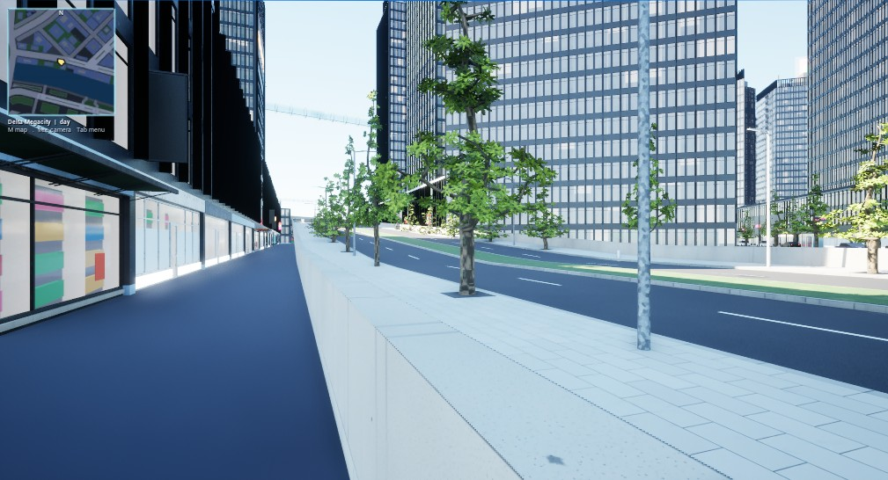
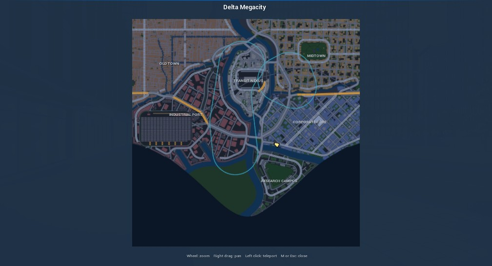
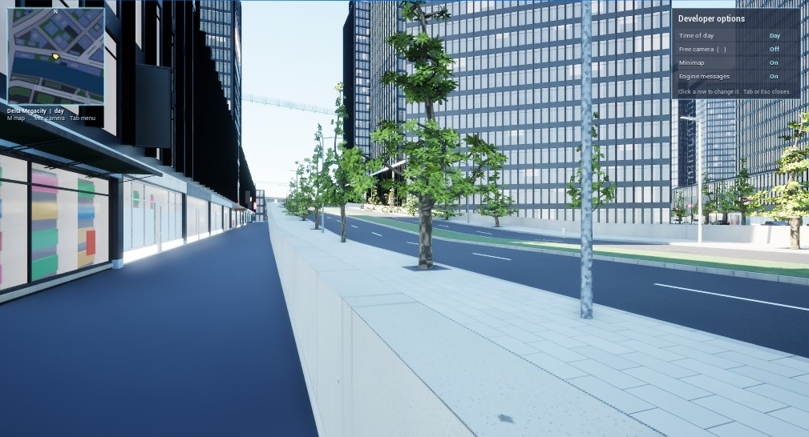
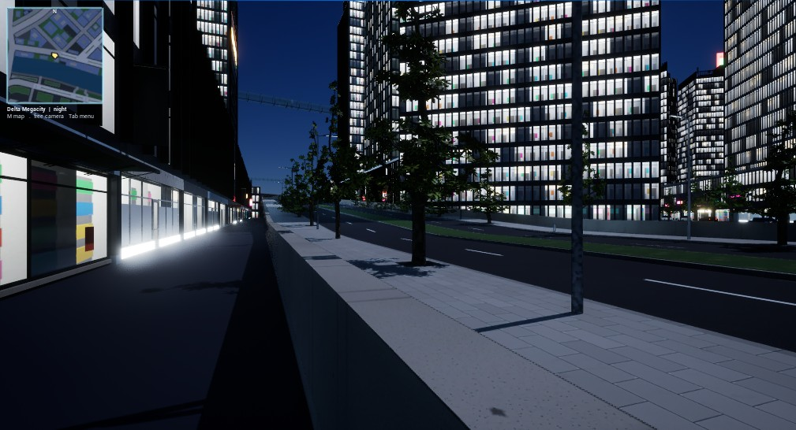
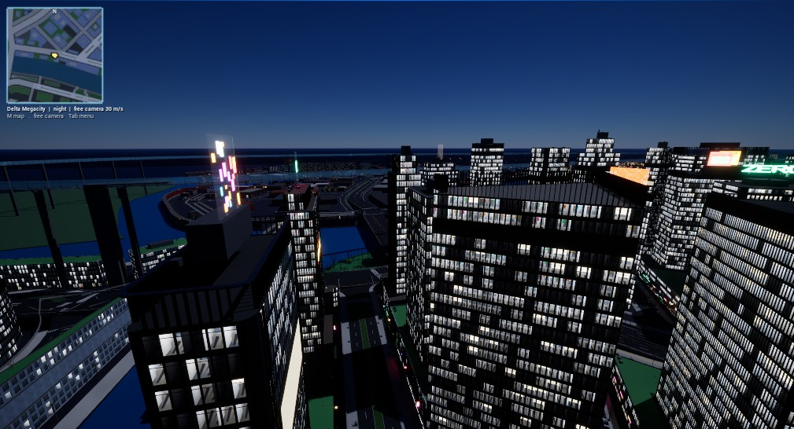

# Play features (Unreal exporter)

An exporter update, not a milestone: every `citygen unreal` import now gives the level a
minimap, a map with teleport (M), an in-game free camera (`.`) and a developer menu (Tab)
with day and night. Spec: [`docs/unreal_export.md`](../../unreal_export.md), "Play features".

| | |
|---|---|
|  |  |
| the minimap, top left | M: the map (wheel zoom, right drag, left click teleports) |
|  |  |
| Tab: the developer menu | night: lit rooms, neon, street lights |

The free camera 120 m over the player by night (Delta Megacity).

## How it is built

Unreal's Python cannot write Blueprint graphs (the UMG toolset of UE 5.8 lays out widget
trees, not event graphs), so the game logic is a C++ runtime plugin, `CityGenPlay`
(`citygen/ue/CityGenPlay`): an actor (`ACityGenPlay`, key `play`, always loaded), a Slate
overlay drawn by hand (`SCityGenOverlay`), a spectator pawn for the free camera and
`CityGen.*` console commands. `citygen unreal` copies it into the project and builds it with
UnrealBuildTool before importing; the map image and the play data come from the venv side
(`citygen/unreal_play.py`).

## Runs (Windows PC, UE 5.8.4, RTX 4070 Ti)

| City | What | Result |
|---|---|---|
| Testport (small test city, blockout) | import into a fresh project, plugin built (14 s), `--check --shots` | all checks pass; play features: map, menu, night (47 lamps lit), free camera and back, teleport 999 m onto the ground; 4 min 26 s in all |
| Delta Megacity (with stage 2) | import into a fresh project (46 min; 71 min the first time on this PC, before Unreal's derived data cache had its meshes), HLODs (6 min, exit 0 now that empty shell meshes are gone), `--check --shots` (20 min) | all checks pass; play features: night (47 lamps lit), free camera and back, teleport 1,755 m onto the ground |
| Full test suite (before merging main) | 7 h 52 min with both Unreal import tests | 669 passed; `test_ag_props::test_golden` failing as before on Windows (main has since written its golden again); one test fixed after |

## Notes

- **The compiler.** UE 5.8 bans MSVC 14.39 to 14.43 (and 14.44 before build 35211); this PC
  had 14.39 and was updated to Visual Studio 2022 17.14 (MSVC 19.44.35229). On a Mac the
  plugin needs Xcode. Without a compiler the import goes on without the play features.
- **Live Coding.** UnrealBuildTool refuses every editor build of an engine while any editor
  of it with Live Coding is open; the plugin build passes `-NoHotReloadFromIDE` (the project
  being imported is closed anyway).
- **The texture pool notice.** Delta Megacity's textures overflow the GPU's streaming pool
  (7 GB here); the engine's red notice is drawn over the minimap. The developer menu's
  "Engine messages" row hides the engine's on-screen messages (the switch the console's
  `DisableAllScreenMessages` sets); the check hides them for its shots. Setting a smaller
  pool in the project was tried and dropped: the engine's default here (70% of the GPU's
  memory) is already the larger.
- **First Play of a big city** takes minutes (every cell within 1.5 km loads first, Windows
  Defender scans each file): `docs/unreal_export.md`, "Opening a big city".
- **Not yet run on a Mac.** The plugin is plain engine API (no Windows calls) and builds
  clean with MSVC; a Mac needs Xcode and has not compiled it yet.
