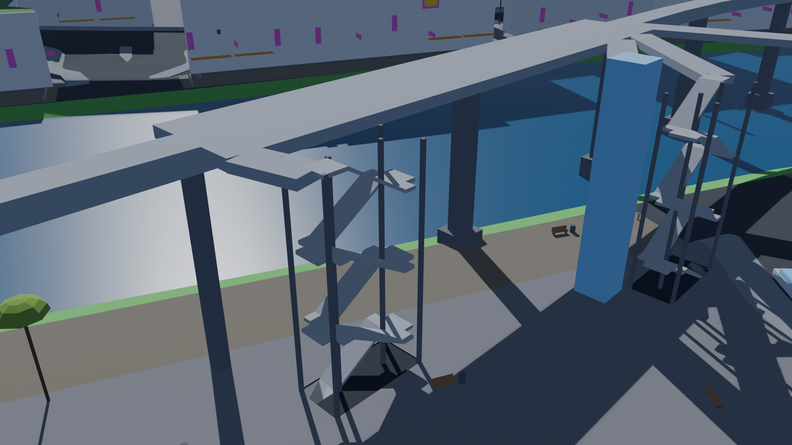
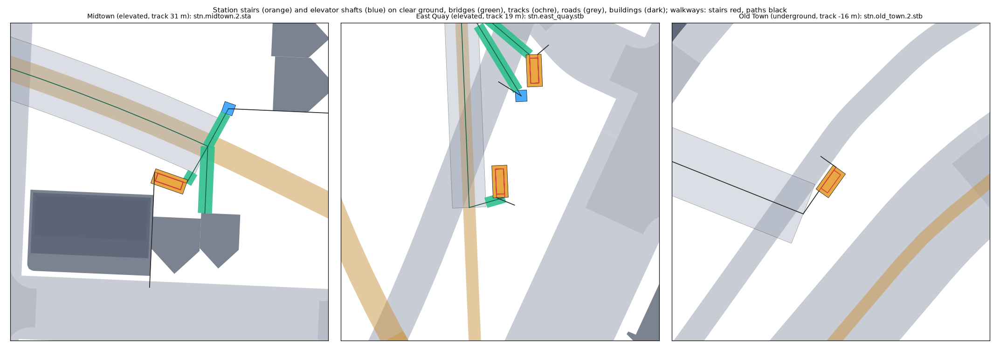

# Station stairs (station_stairs)

Built on the Windows PC (2026-11-20), from #250's two open items (`docs/progress/city_open_items`):
station stairs that passed the grade were still straight walkways from the platform to the
sidewalk, 70 to 180 m long through the air, and no station stair or elevator was drawn, so
lifegen's people climbed through the air at every elevated station. Delta was built again on the
branch (`C:/Users/swagn/CityGen/builds/delta_stairs`, the same steps as `delta_next`:
`citygen build --blockout --no-render`, `assetgen build --workers 2`, `atmosgen plan`, `lifegen
plan --atmos`).

| Part | Where | What |
|---|---|---|
| Stairs that can be built | `citygen/transit.py` (`stair_plan`, `Builder._tower`, `_well`, `_lift`, `_lift_here`, `_spot`, `_clear_index`, `_dyn`, `_bridge_ok`, `_ground_ok`; `FLIGHT_*`, `SHAFT_*`, `ACCESS_*`) | every station stair is switchback flights with landings in a short footprint on clear ground beside its platform or concourse end, else an elevator shaft there, else an elevator straight down |
| Check | `citygen/transit_checks.py` (`check_station_stairs`) | `station_stairs`: a stair walkway on no buildable flight, off clear ground or outside its stair fails, an elevator outside a shaft fails |
| Blockout | `citygen/blockout.py` (`_station_stair`, `_land_and_water`) | flights and landings, posts, a metro well's lining (the ground opened over it), elevator shafts |
| AG7 | `assetgen/streets/transit.py` (`make_station_stair`, `make_station_elevator`, `maker_for`) | AG10's flights, landings with guard rails, posts; a metro well's lining, floor and parapet; glass shafts with machine rooms and doors |
| Map | `citygen/unreal_play.py` | stairs and shafts on the play features' map |
| Tests | `tests/test_transit.py`, `tests/assetgen/test_ag_streets.py` | flights on clear ground and the check failing two broken copies; every station stair or elevator walkway has a blockout object and an AG7 surface under it |

## 1. Stairs that can be built

**Cause.** `transit.Builder._elevated` drew a platform end's stair as one walkway from the end (on
the track, 15.8 to 31 m up) straight down to its sidewalk point; #250 capped its grade at 0.7, so
a far sidewalk point gave a stair 70 to 180 m long at 0.2 to 0.45 and a near one a bridge out over
the sidewalk and an elevator down onto it. A metro stair ran from the sidewalk to the concourse's
end, up to 94 m long underground. None stood on anything.

**Fix.** Every station stair is flights a stair is built of (`stair_plan`): the rise in flights of
at most `FLIGHT_RISE_M` 3.6 m (20 risers) at `STAIR_GRADE` 0.62, one straight flight or
switchbacks side by side (`FLIGHT_W_M` 2 m wide, a 0.3 m well between) with a landing a flight wide
at each end: a 31 m platform's stair is nine flights in a 9.6 by 4.3 m tower, a 19 m one's six,
a metro well three flights down 8 m in 8.3 by 4.3 m. Its footprint stands on clear ground
(`_spot`, on a 1 m grid of middles along and across the track within `ACCESS_REACH_M` 36 m of the
end, 60 m for a metro well; `_clear_index`, `_dyn`): off every road's right of way (its lanes,
crosswalks and sidewalks), junction, building mass, water body, structure, M14 slab, megasite
element, skybridge, every line's track (its own by a meter, the others' by `SIDE_PAD_M` more) and
every walkway but the sidewalks and crossings, by `ACCESS_PAD_M` 0.5 m. An elevated platform end's
tower has its top landing toward the end and a bridge to it at the platform's height
(`_bridge_ok`: through no building mass at its height, the check's own test, off the other lines,
never along its own track past the platform, at most `ACCESS_BRIDGE_M` 40 m; a glazed, roofed
`skywalk` deck `<station>.sb<a|b>` from the platform's edge to the tower); a metro well a passage
at the concourse's depth from its foot to the concourse's end, under no building. From the
stair's ground end a path runs to the sidewalk, through no building (`_ground_ok`). The stair is
one `stairs` walkway along its flights and landings (`attrs.structure`) and a structure of kind
`stair` (`<station>.st<a|b>`: its footprint, the walkway's line, `attrs` frame, length, width,
flights, rise and run of a flight). Where no stair fits, an elevator shaft (`SHAFT_M` 3.2 m,
kind `elevator`, `<station>.el<a..d>`, its stops and `doors`) stands there the same way; where no
clear ground is near, an elevator goes straight down from the end with its shaft where it stands
(`attrs.clear` false; none beside another line, where the station's other end serves it). An
elevated station with no shaft gets one beside its first or last end. #250's bridges over the
sidewalk point (`lift_bridge`) and stepped metro stairs are gone; `station_access` still fails a
stair steeper than 0.7.

**Check.** `station_stairs` (one more transit check: 109 on a flat sample, 114 with decks): every
station stair walkway lies inside its stair structure, every flight rises at most 3.6 m at 0.7 a
meter at most with a landing between two flights, and the stair stands on no road, junction,
crosswalk, building mass or water; every elevator of an elevated or underground station rides in
a shaft from its lowest stop to its highest; a shaft with no clear ground near is noted.

## 2. Drawn under every walkway

The blockout draws a station stair (`_station_stair`) as strips a flight wide along each leg of
its walkway at its heights (flights and landings), steel posts at its corners and its landings'
inner ends up to its top, and a metro well as its flights inside a lining from its floor to the
parapet, the ground opened over it (`_land_and_water`); an elevator as its shaft from its lowest
stop to its machine room (`structure_stair`, `structure_elevator`, keyed by the structure's id).
AG7 replaces them (`make_station_stair`: AG10's flights, a block a step on a sloped soffit with
stringers and handrails, a concrete landing at each end of every flight with guard rails round
its open edges, the top landing open to its bridge, steel posts; a metro well lined, floored and
railed; `make_station_elevator`: glass between steel corner posts, bands every 3 m, a concrete
shaft under the ground down to a concourse, its machine room and a cab door at each stop above
the ground facing its way). The tests check that every point of every station stair walkway has
a tread or landing under it, and every elevator a shaft round it. **Exporter:** nothing new; the
pieces replace the blockout's objects by key through stage 2.

## Delta on the branch

| | main (#250) | branch |
|---|---|---|
| Station stairs | 12 straight walkways (elevated 29 to 134 m, metro 18 to 94 m), nothing under them | 22 stairs of 146 flights: 20 elevated stair towers (12 of six flights at 19 m, 2 of seven at 24.9 m, 6 of nine at 31 m) and 2 metro wells of three flights |
| Elevators (elevated and underground stations) | 19 walkways, no shaft | 15 in shafts: 11 elevated (10 on clear ground with a bridge, 1 straight down at West Quay) and 4 metro (1 on clear ground with a passage, 3 straight down from the concourse) |
| Bridges and passages | 10 bridges over the sidewalk point | 30 bridges, 6 to 33 m; 3 passages, 8 to 30 m |
| Station stair or elevator walkways with nothing under them | every one | none |

STAGES_TABLE

## Cities whose models moved

HASHES_TABLE

## Open items

- **Dense ground:** where no stair or shaft fits within reach (Delta's West Quay, three metro
  concourse ends under the Corporate Core, Old Town and Transit Nexus avenues), the elevator goes
  straight down from the end and its shaft stands where it lands, in the road or the sidewalk
  (`attrs.clear` false, noted by `station_stairs`). A stair along the sidewalk's furniture zone,
  or into a building's ground floor, would serve them.
- **Metro wells** open the blockout's ground, not the pavement map or M13's terrain grid: a well
  never stands on a road, but on a terrain city its opening is under the ground's heightfield.
- **Sky stations** keep M19's elevator cores and their towers' lifts.
- **Terrain:** a stair tower's height is its platform's z over the ground at the tower, not at
  the platform (M5's frame); no sample has an elevated station on a slope.
