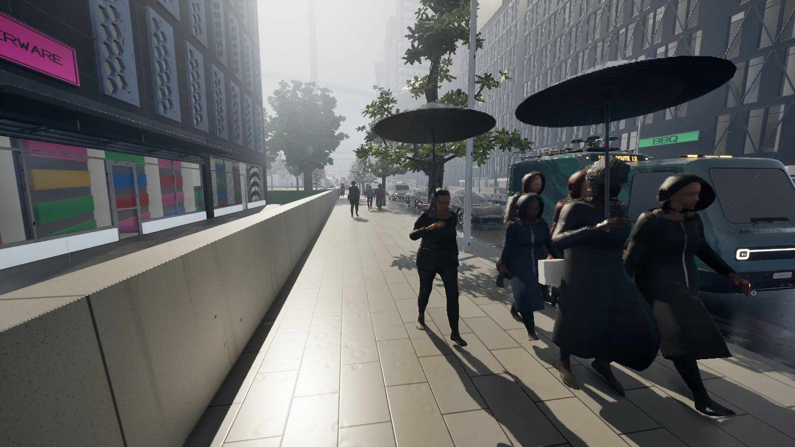
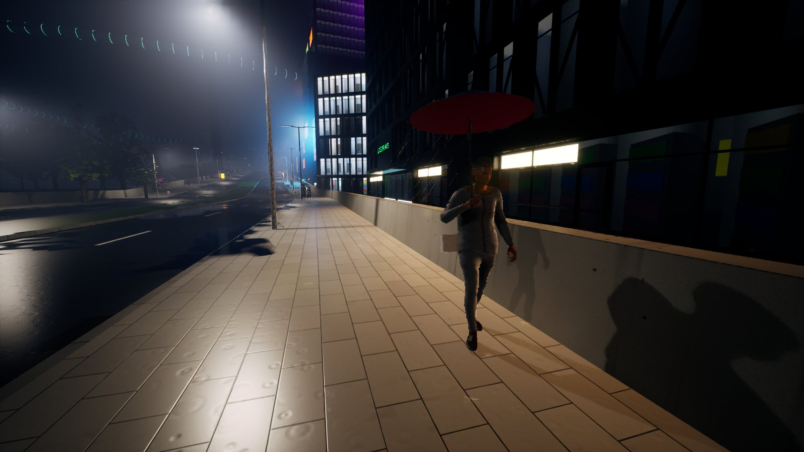
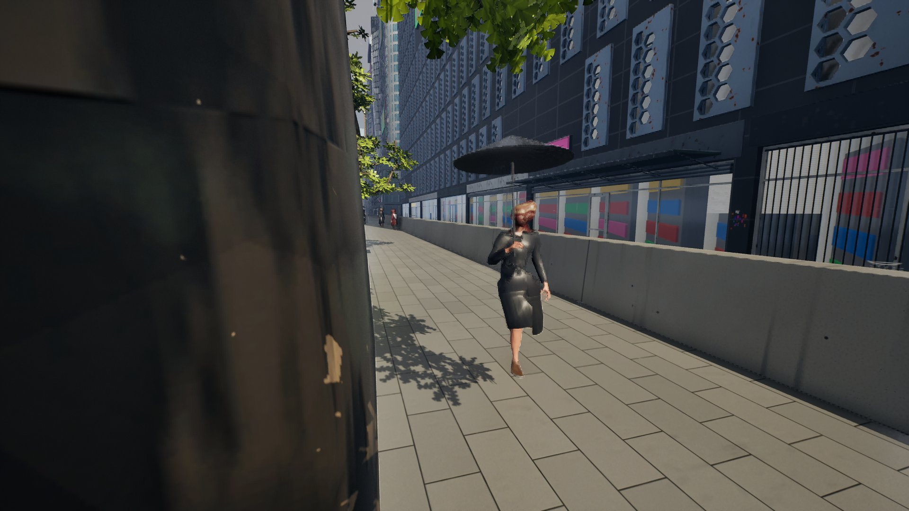
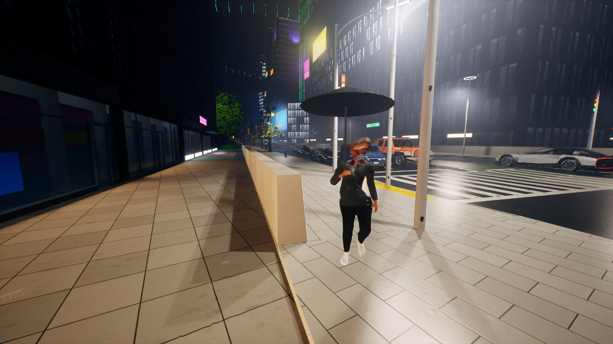
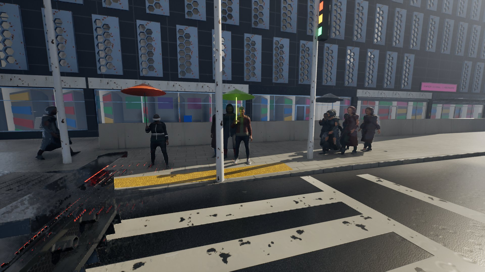
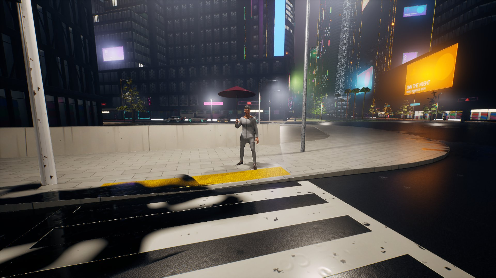
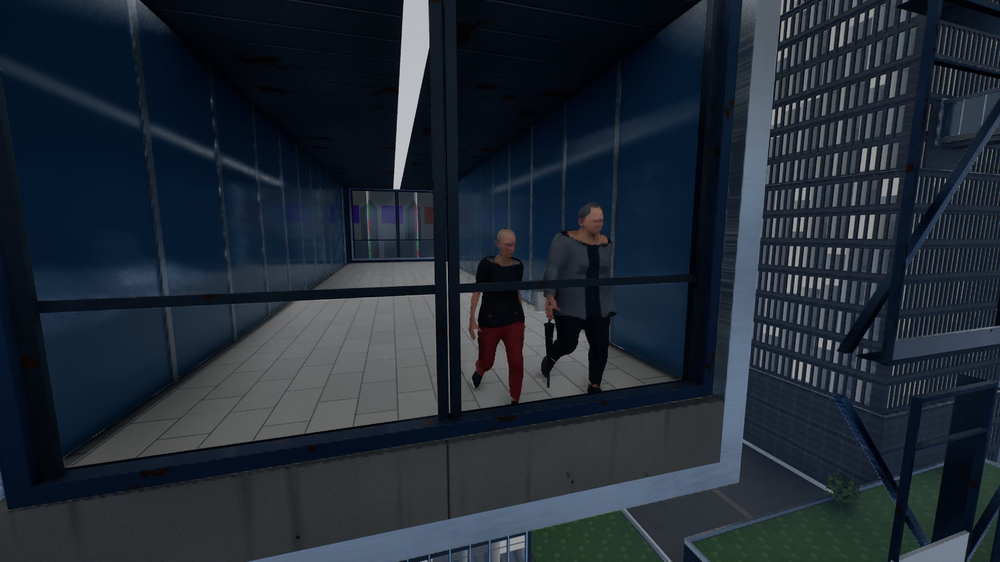
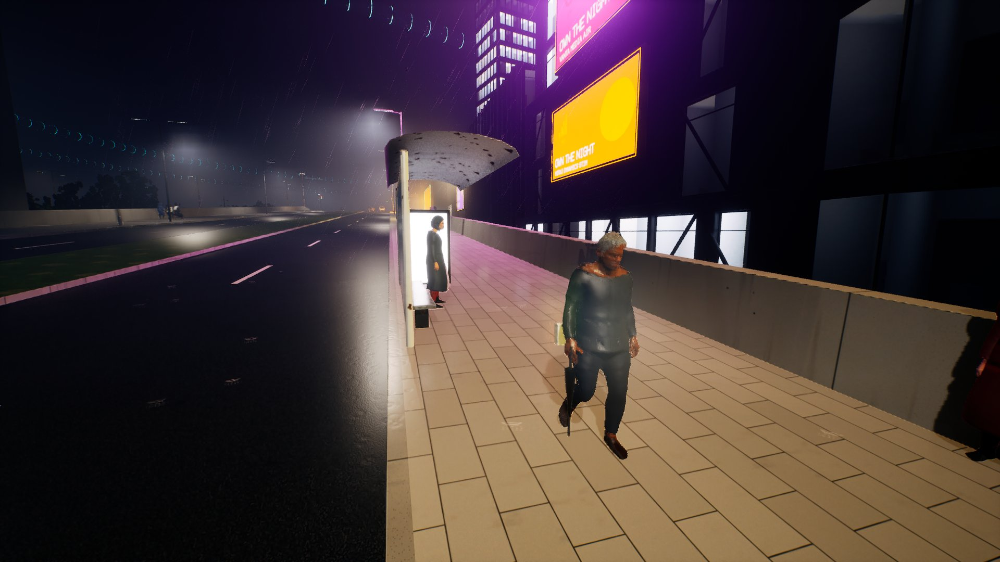
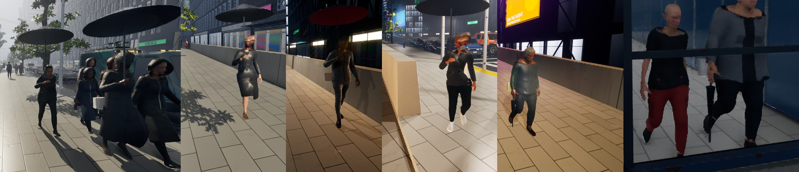
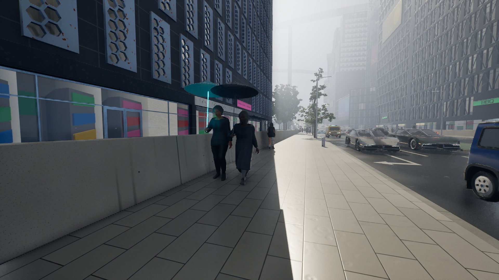

# Umbrellas held (umbrella_hold)

Built on the Windows PC (2026-11-18), on main after people_surfaces (#244). Swagnik's walk of
the packaged Delta: in rain the umbrellas "just float alongside" people. LG8 drew a canopy and a
shaft over the right shoulder of the near and mid people holding one, no hand on it, no arm
posed. Now the umbrella is held in the right hand, the arm up, near and mid.

| Part | Where | What |
|---|---|---|
| The held arm | `citygen/ue/people_places.py` (`hold_pose`, `held_clip`, `umb_walk`, `mid_bake`), `citygen/unreal_people.py` (`UMB_HOLD`, `mid_key`, `idle_bake`) | per clip group the right arm posed by two-bone IK on its standing idle, written as a clip (`A_umb_hold`); the walk and the idle with the arm held baked as two more loops of each look's second mid bake |
| Exporter | `citygen/unreal_life.py` (`idle_data`: `umb_hold_clips`, `umb_grip`, `mid_umb_frames`; `PACK_VERSION` 11), `citygen/ue/import_city.py` (`people_assets`; `LIFE_VERSION` life13) | the held clip and grip per group, the held loops' frames per look |
| Near | `CityGenLifeAnim.h`, `.cpp` (`UCgPersonAnim::SetHold`, `HoldTarget`, `HoldW`, the proxy's layer), `CityGenLifePeople.cpp` (`Assign`, `UpdatePeople`), `CityGenLifeWeather.cpp` (`MakeUmbHold`, `UmbOpen`, `UpdateUmbrellas`) | the held arm layered over whatever clip plays, blended in and out; the umbrella in the drawn hand; folded under a cover, the arm down and the umbrella hanging from the hand |
| Mid | `CityGenLifePeople.cpp` (`LookData`, `CgLook::Umb`), `CityGenLifeWeather.cpp` | the bake's held walk or idle, the umbrella at the bake's grip |
| Shots | `CityGenLifeWeather.cpp` (`ShowWeather`: `umbrella_still`, `umbrella_folded`, closer framing), the weather status | |
| Tests | `tests/lifegen/test_lg_people.py` (`test_exporter_packs_the_umbrella_hold`, `test_mid_key_follows_the_hold`), `tests/lifegen/test_lg_weather.py` (the pack version) | |

## The held arm

**Pose.** The Game Animation Sample has no clip of a held umbrella, so the arm is posed. The
places' step (which already retargets the sample's bench and talk clips onto each clip group's
body) takes the group's standing idle (`idle_relaxed`) at its first frame and reads its bones in
the component's frame (`unreal.AnimPoseExtensions`). It first checks that each of the upper arm,
forearm and hand is its parent's child as assumed (rotation and place from the parent's, within
0.002 rad and 1 mm), so a skeleton chained otherwise stops the step instead of baking a broken
arm. The body's forward is the toes' way (foot to ball, checked against the cross of the
shoulders and up: they agree on Delta's group, `toe_dot` 1.0), right is the right shoulder from
the left. The hand goes, by two-bone IK, to the shoulder joint plus fractions of the arm's length
(`UMB_HOLD`): on Delta's 47 cm arm 22 cm ahead, 3 cm out and 8 cm down; the elbow toward back,
out and down (the forearm rising in front of the shoulder, clear of the chest); the wrist
straight on its forearm (the palm stays inward, the thumb up, the natural grip of a vertical
shaft). The IK lands the hand on its target exactly (`error_cm` 0.0). The grip is 15% of the
arm's length on from the wrist along the forearm (the palm's middle).

**Clips.** `A_umb_hold` is the idle with the upper arm's, forearm's and hand's rotations held at
every key (their places the clip's, every other bone the idle's); `A_umb_walk_<walk>` the
library's walk with the same three held. Both are made once and kept while they carry the mid
bakes' key.

**Near.** `UCgPersonAnim` takes the group's three held rotations (read once from `A_umb_hold`'s
first key, `MakeUmbHold`) and, after its clip and crossfade, sets the three bones' rotations in
their parents' frames toward them by its hold weight. The shoulder (clavicle) and everything past
the hand stay the clip's, so the arm rides the walk's shoulder and works over any clip (walk,
idle, talk). The weight moves toward 1 while the person's umbrella is open and 0 when it folds,
over `UmbHoldS` (0.35 s), eased. The umbrella stands in the drawn hand: the shaft through the
grip (the `hand_r` socket on along `lowerarm_r` to `hand_r`), leaning back toward the head by
LG8's tilt (6 degrees), the canopy on its top and no lower than LG8's canopy over the head (so a
short person's shaft is longer, never a canopy through a head), a 6 cm handle under the hand. It
shows open once the arm is 60% up; before that, rising, and while the arm is down, the umbrella
hangs furled from the hand (the canopy cone narrowed to 8.5 cm and turned tip down, the shaft
72 cm), so a person stepping under a cover lowers the arm with the umbrella and walks on with it
hanging, and out of the cover raises it and opens it.

**Mid.** The mid tier has no bones: a mid person whose umbrella is open plays its look's held
walk (the same frames as its walk, moved by the bake's offset, so the phase across tiers is
kept) or, standing, the held idle (`CgLook::Umb` on its look, `LookData`), and the umbrella
stands at the bake's grip in the body's frame, the same shaft and canopy rule. Folded (under a
cover), a mid person plays its own walk and no umbrella is drawn.

**Far.** The far cards are unchanged (no umbrella past the mid tier, as LG8's).

## Shots (Delta, Old Town, rain)

Every view with `CityGenLife.WeatherShow` framing the nearest person with an umbrella open,
standing with it open, or with one under a cover; the mid views with the near tier off
(`CityGenLife.Tiers 0 0 90 300`), so the people close to the camera are drawn mid.

| Near, walking, day | Near, walking, night |
|---|---|
|  |  |
| **Mid, walking, day** | **Mid, walking, night** |
|  |  |
| **Standing with it open (at a crossing), day** | **Standing, night** |
|  |  |
| **Folded under a cover (behind the glass, right), day** | **Folded, walking under an awning, night** |
|  |  |

Close up, from the shots above (near day, mid day, near night, mid night, folded night, folded
day):

**First try.** The first pose had the hand 19 cm under the shoulder (the forearm level, the
hand at the waist on Delta's 1.6 m body): held, but low. The hand by the shoulder reads as
holding an umbrella (`UMB_HOLD` version umb2).

## Import, check

- **Import** (`citygen unreal ... --people --atmos --life --dlss`, as people_surfaces'; the
  second with `--no-hlod`): the places' step ran again (three editor runs: the clips retargeted,
  the held clips made, 144 mid bakes with two more loops each, about 1.5 s a look; the still
  sheets kept, their key unchanged), the plugins built, the life controller updated; the first
  import's HLOD pass found nothing to build (760 HLOD actors).
- **`--check`: PASS**, twice (umb1 and umb2; spawn, streaming, collision 505 of 507 traces, the
  walk and the curb, sky and time, air, weather, look, far city, play features, the flight),
  with the shots above (`builds/umbrella_tmp/views.txt`, `view_cmds.json`).
- The weather status at the views: 2 to 44 umbrellas open near and mid, `umbrella_held` and
  `umbrella_mid_held` true, `umbrella_hold_groups` 1 (Delta's one clip group).

No benchmark (the change adds three bone rotations to each near person's evaluation, two socket
reads to each near umbrella, a few more custom data writes as mid people open or fold theirs).

## Choices

- **Posed by IK on the idle, not a clip:** the sample has no umbrella clip. One pose per clip
  group, held as rotations in the parents' frames, serves near (layered) and mid (baked), so the
  arm is the same in both tiers.
- **Layered from the upper arm down** (three bones): the shoulder moves with the walk and the
  fingers keep the clip's relaxed curl, which wraps the shaft at this distance. No finger pose.
- **Folded:** near, hanging furled from the hand; mid, not drawn (the mid tier has no hand to
  hang it from: its walk swings the arm).
- **The shaft vertical** (leaning back by LG8's tilt), placed by the hand's position, not its
  orientation, so the IK's wrist needs no exact grip axis; the canopy height keeps LG8's rule as
  a floor, so it never meets a head across the characters' heights.
- **Mid bakes keyed apart** (`mid_key`): moving the hold bakes the mid tier again (about 3.5
  minutes for 144 looks) without capturing the still sheets again (`idle_key` unchanged).

## Open

- The umbrellas are still the engine's basic shapes (a cone and a cylinder) until the Mac
  designs one.
- Far people (90 to 300 m) carry no umbrella.
- A mid person holding a folded umbrella shows none.
- Not packaged yet (the next step).
