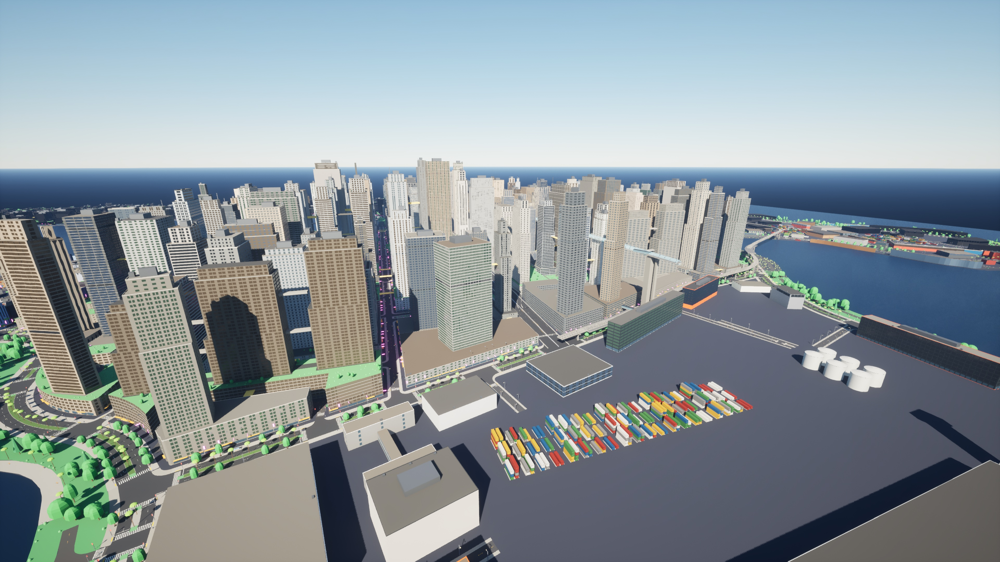
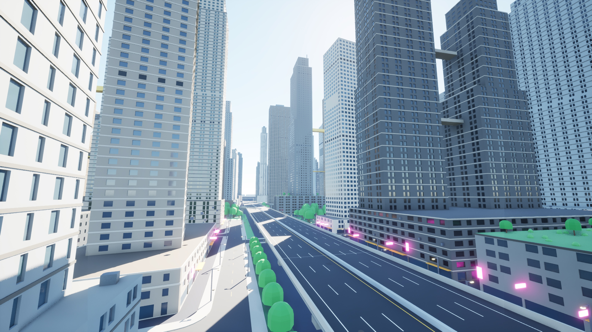
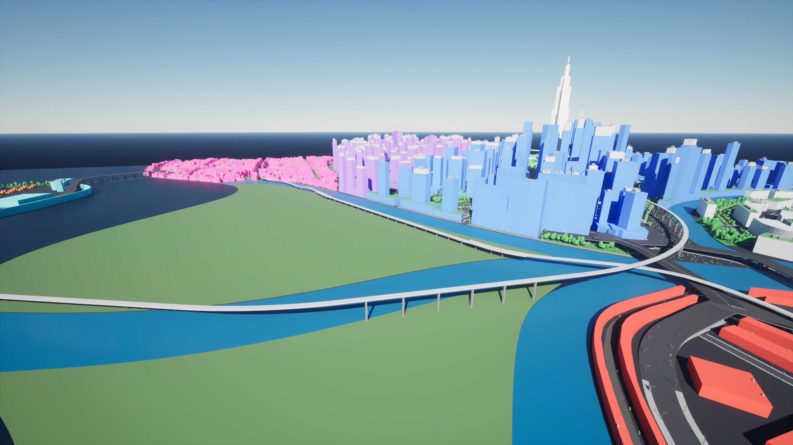
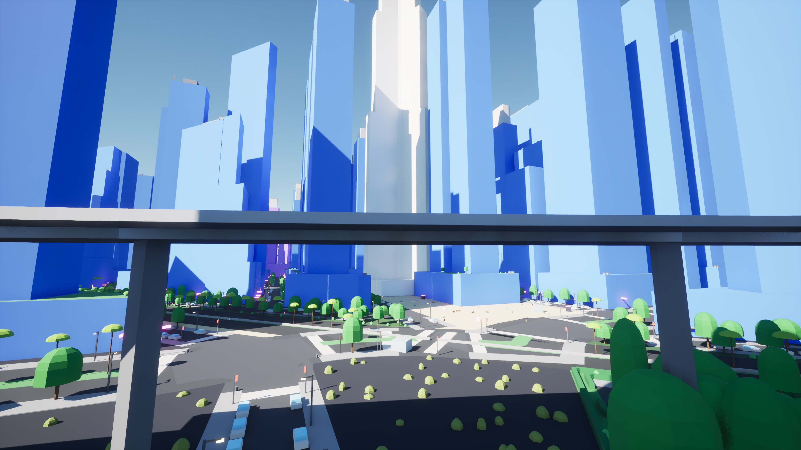

# Open, play and fly: the exporter after stage 2

`citygen unreal` now leaves a project ready to play. Opening it opens the city, Play puts you
in it, flying by default, and the far view streams in as you fly. The user guide is in
`docs/unreal_export.md` ("Import, open and play"); what the importer does:

- **Startup map.** After a successful import the city's level becomes the project's
  `EditorStartupMap` and `GameDefaultMap` in `Config/DefaultEngine.ini`; the rest of the file
  is left as it was, its line endings too (`unreal.set_startup_map`). `--no-startup` opts out.
- **Fly pawn.** `Core/BP_CityGenFlyPawn` is a SpectatorPawn Blueprint made the way the importer
  makes `BP_CityGenInstances`: its built-in bindings, no collision, 50 m/s (`--fly-speed`).
  `Core/GM_CityGenFly` spawns it. With `--play fly` (the default) it is the level's World
  Settings game mode override; with `--play walk` the override is cleared, so Play uses the
  project's own game mode and pawn, and `ghost`, `fly` and `walk` work on it as usual.
- **Streaming for flying.** World Partition's runtime hash in a new level has a main grid
  partition (128 m cells loaded within 256 m) and two HLOD partitions (the defaults the engine
  makes, at twice the size and range of the one before). The importer sets the main grid to
  256 m cells (one per blockout tile) loaded within 1500 m (`--view-range`), and the first
  HLOD partition to 512 m cells loaded out to the city's diagonal (Vesper Bay 4.9 km). None of
  these properties is exposed to Python under its snake_case name, so they are set by their
  C++ names (`CellSize`, `LoadingRange`).
- **HLODs.** The level's default HLOD layers (instanced, with a merged layer over it) were
  made with the level but never built. After the import, `citygen unreal` runs the engine's
  HLOD builder on the level (`UnrealEditor-Cmd -run=WorldPartitionBuilderCommandlet <level>
  -Builder=WorldPartitionHLODsBuilder -AllowCommandletRendering`; it renders, so it runs
  without `-nullrhi`). An import over an unchanged build rebuilds none of them. `--no-hlod`
  skips it. The merged layer is cut off (the instanced layer's parent cleared), so the far
  view is the city's own meshes and materials, nothing baked, which Nanite keeps cheap at a
  distance.
- **Check.** `--check` plays the level twice and does not save it. First it walks with the
  project's own pawn, whatever `--play` set (the level's override is cleared in memory), and
  runs `ghost`, `fly` and `walk` on it. Then it flies with the fly pawn: a straight run of 8
  s at full speed from 40 m over the player start toward the city's middle, through whatever
  stands in the way, timed on the game's clock. It checks the city has streamed in where the
  run ends, and with `--shots` it takes two views from the fly pawn while playing
  (`HighResShot` in the play world, so they show what streaming has loaded).

Every setting is written only when it differs, so an unchanged build imported again saves
no package and writes no file (the fly pawn's speed and collision persist in its Blueprint).

## Runs

The M4 Mac, UE 5.8.4, the exporter's own throwaway project (`CyberGenImportTest`, made with
`--new-project` from the First Person template in M15). Both cities were imported over their
earlier imports, then again with the fixes below, then checked.

| City | Import | HLODs | Check |
|---|---|---|---|
| Vesper Bay, blockout only | over its earlier import: no actor changed, the level saved once (its game mode and grids, 25 s); again: nothing saved (21 s) | first 319 built (98 s), again none rebuilt (36 s); with the fixes 244 (the merged ones gone) | pass (436 s) |
| Greyhook with stage 2 (AG1 shells, AG7 streets) | over its M15 import: 9786 created, 987 updated, 3951 deleted (10971 in all; stage 2's 7884 actors over 3672 blockout actors), 69 min; with the fixes: no actor changed, the level saved once (65 s) | first 360 built (9.4 min), with the fixes 285 (164 s) | pass (821 s) |

Most of Greyhook's first import went into deleting the 3244 meshes its M15 import used and
this one does not (65 minutes, while three other sessions' Unreal tests ran on the same Mac;
the stage 2 record has the same: Unreal is slow to delete thousands of meshes). The play
settings themselves take under a second of an import.

| City | Walking (First Person character) | Console | Flying (fly pawn) |
|---|---|---|---|
| Vesper Bay | 6855 of 10413 actors loaded at the start; 507 of 507 traces down, 36 of 36 roofs and facades; 253 m walked, every frame on the ground, reached its end | `ghost` flying without collision, `fly` flying, `walk` walking | 397 m in 7.9 s of game time (50 m/s) through `d01.lot.e43n235.bld`; 6819 actors loaded where it ended |
| Greyhook with stage 2 | 8847 of 10971 loaded at the start; 507 of 507, 36 of 36, 36 of 36; 129 m walked, reached its end | the same | 365 m in 7.3 s (50 m/s) through `d03.lot.e32s178.bld`; 7701 loaded where it ended |

With 1500 m of view range most of a sample city is loaded at the start, so the check's
teleport across the city loads fewer new actors than before (1010 on Greyhook); it still
finds the far tile loaded.

## Fixed on the way

- **The far view was flat gray.** The first shots from the fly pawn showed the city beyond
  the view range in one flat gray: the log said every blockout and stage 2 material was
  "missing usage flag InstancedStaticMeshes! Default Material will be used in game", and the
  instanced HLODs are instanced static meshes. `M_CityGen` and the stage 2 masters are now
  made with that flag, and an existing project gets it on its next import (`instanced`).
- **The check's streaming count** read the actors loaded at the start after teleporting away,
  when some had streamed out ("ObjectInstance is null"); it counts them before the teleport.
- **The flight's speed** is timed on the game's clock: on the wall clock Greyhook's first
  flight came out at 40 m/s, because play-in-editor clamps a long frame.
- **No console speed tip.** The console's `set` would change the fly speed in a game, but the
  editor refuses it ("Set commands not allowed in the editor"); the speed is `--fly-speed`,
  or the pawn's movement component in the editor until the next import.

## Shots from the fly pawn

Taken while playing, 3840 px: what streaming and the HLODs show from the pawn.

| Greyhook from 220 m, toward its middle | Greyhook low over a street |
|---|---|
|  |  |

| Vesper Bay from 220 m | Vesper Bay low over a street |
|---|---|
|  |  |

`results.json`: the imports', HLOD builds' and checks' results.

## Not checked here

- The keys. The check moves the fly pawn by movement input, so pressing W, A, S, D, E, Q and
  the mouse is left for a first Play by hand. They are the engine's own SpectatorPawn
  bindings (`DefaultPawn.cpp`, legacy axis mappings), and Enhanced Input, which the First
  Person template turns on, still evaluates legacy bindings.
- The Windows PC. The paths in the guide are Windows ones, and the importer finds
  `C:\Program Files\Epic Games\UE_5.*`, but nothing here ran on Windows.
